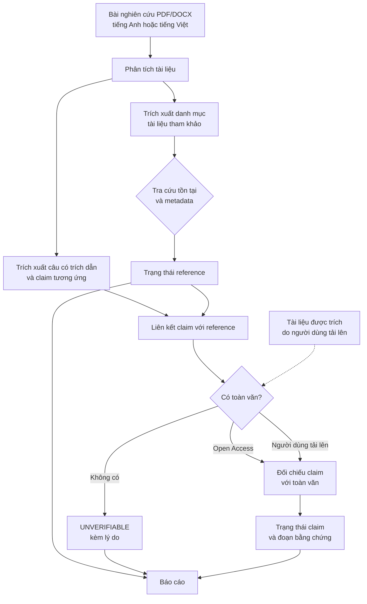

# 00 — Project Overview: CiteProof AI

| Thuộc tính | Giá trị |
|---|---|
| Phiên bản | 0.1 |
| Phase | Phase 0 — Project Initialization |
| Ngày cập nhật | 20/11/2026 |
| Trạng thái | IN_REVIEW |
| Tài liệu đầu vào | CiteProof AI Project Documentation v1.0 (`reference/citeproof-v1.0.md`) |
| Tài liệu liên quan | [`01-idea-analysis.md`](01-idea-analysis.md), [`project-status.md`](project-status.md) |

**Quy ước đánh dấu** dùng trong toàn bộ bộ tài liệu:

| Ký hiệu | Ý nghĩa |
|---|---|
| `[XN]` | Đã xác nhận: có trong Decision Log, hoặc có sẵn trong v1.0 và nằm trong ranh giới MVP |
| `[GĐ]` | Giả định: cần kiểm chứng, thường ở Phase 1 |
| `[ĐX]` | Đề xuất: chờ bạn quyết định |

---

## 1. Overview

CiteProof AI là công cụ AI giúp người viết bài nghiên cứu kiểm tra ba điều về tài liệu tham khảo của mình: tài liệu có tìm thấy được không, thông tin trích dẫn có đúng không, và tài liệu đó có thực sự hỗ trợ nhận định đã trích hay không. Mỗi kết luận đi kèm đoạn bằng chứng gốc. Khi không thể kết luận, hệ thống nói rõ lý do.

Tài liệu v1.0 mô tả tầm nhìn đầy đủ: 9 Agent, truy xuất mở trên nhiều nguồn, phát hiện bằng chứng trái chiều, định hướng B2B. Tài liệu này xác định **phiên bản dự án thực tế cho giai đoạn hiện tại**: một người thực hiện, MVP trong 3–6 tháng, kết hợp nghiên cứu và sản phẩm. Tầm nhìn v1.0 được giữ làm định hướng dài hạn.

### 1.1 Định nghĩa dự án (phiên bản MVP)

> CiteProof AI (MVP) nhận một bài nghiên cứu tiếng Anh hoặc tiếng Việt thuộc lĩnh vực Khoa học máy tính – AI. Hệ thống kiểm tra từng tài liệu tham khảo có tìm thấy được và đúng metadata không. Với tài liệu truy cập được toàn văn, hệ thống đánh giá mức độ tài liệu đó hỗ trợ nhận định được trích, kèm bằng chứng truy xuất được. Mọi trường hợp không đủ cơ sở đều được báo rõ lý do thay vì đoán.

Khẩu hiệu giữ nguyên từ v1.0: **Verify every claim. Trust the evidence.**

### 1.2 Bài toán trọng tâm

v1.0 gộp hai bài toán có độ khó rất khác nhau. MVP chỉ giải bài toán thứ nhất `[XN]` (D-04).

| | Citation fidelity (trong MVP) | Open-domain claim verification (ngoài MVP) |
|---|---|---|
| Câu hỏi | Tài liệu được trích có hỗ trợ câu này không? | Giới khoa học nói chung có ủng hộ nhận định này không? |
| Phạm vi tìm bằng chứng | Một tài liệu đã biết | Toàn bộ tài liệu khoa học |
| Claim được xác định nhờ | Vị trí trích dẫn trong câu | Phải tự phát hiện trong toàn bài |
| Độ khó | Có giới hạn rõ, đánh giá được | Truy xuất mở, khó hơn nhiều bậc |

## 2. Objectives

Nguyên tắc chung `[XN]` (D-01): **một bộ đánh giá, hai mục đích**. Tập dữ liệu có nhãn và script đo lường vừa đo chất lượng sản phẩm, vừa là thực nghiệm cho bài báo. Không chạy hai luồng công việc tách biệt.

### 2.1 Mục tiêu sản phẩm

| ID | Mục tiêu | Trạng thái |
|---|---|---|
| SP-1 | Người dùng phát hiện được tài liệu tham khảo sai metadata hoặc chưa tìm thấy, mà không bị gán nhầm là "bịa trích dẫn" | `[XN]` |
| SP-2 | Người dùng biết những trích dẫn nào có thể không hỗ trợ nhận định, kèm đoạn bằng chứng để tự kiểm tra | `[XN]` |
| SP-3 | Một nhóm nhỏ người dùng thử (pilot) dùng được prototype và đưa phản hồi | `[XN]` (v1.0 §3.3, Stage 1) |

### 2.2 Mục tiêu nghiên cứu

| ID | Mục tiêu | Trạng thái |
|---|---|---|
| NC-1 | Xây dựng bộ đánh giá cho bài toán citation fidelity trong lĩnh vực CS–AI, song ngữ Anh–Việt | `[XN]` |
| NC-2 | So sánh các cách tiếp cận (Single LLM, RAG trên toàn văn, pipeline nhiều bước), lấy **ngôn ngữ claim (Anh / Việt) làm trục chính**; điều kiện truy cập (abstract / toàn văn) là trục phụ vì đã có công trình liên quan (`02` §4.4) | `[ĐX]` (cập nhật 20/11/2026) |
| NC-3 | Phân tích trade-off giữa chất lượng, chi phí và độ trễ | `[XN]` (RQ5 của v1.0) |

Câu hỏi nghiên cứu chính thức được chốt sau literature review ở Phase 1. Bản nháp và cách ánh xạ với RQ1–RQ5 của v1.0 nằm ở `01-idea-analysis.md` §4.6.

### 2.3 Tiêu chí thành công

Giữ cách tiếp cận của v1.0 §21: chỉ số định lượng chỉ được đặt sau khi có baseline và dữ liệu thử nghiệm. Ở mức định tính, giai đoạn MVP thành công khi:

- [ ] Prototype chạy hết luồng MVP (§3.5) trên bài thật, cả tiếng Anh và tiếng Việt.
- [ ] Có bộ đánh giá kèm annotation guideline, và có kết quả của các baseline đã chọn.
- [ ] Có người dùng pilot thực tế sử dụng và phản hồi.
- [ ] Có bản thảo bài báo hoặc báo cáo nghiên cứu với phần Limitations trung thực.

## 3. Scope

### 3.1 Người dùng mục tiêu

| Stage | Đối tượng | Trạng thái |
|---|---|---|
| Stage 1: MVP / pilot | Sinh viên ngành CS–AI viết tiểu luận, khóa luận bằng tiếng Việt hoặc tiếng Anh | Lĩnh vực, ngôn ngữ `[XN]`; nhóm pilot cụ thể `[GĐ]` |
| Stage 2 | Học viên cao học, nghiên cứu sinh, giảng viên CS–AI | Sau MVP |
| Stage 3–4 | Nhóm nghiên cứu, trường, tạp chí, nhà xuất bản | Định hướng dài hạn (v1.0 §3.3) |

### 3.2 Trong phạm vi MVP

| Hạng mục | Nội dung | Trạng thái |
|---|---|---|
| Đầu vào tài liệu | Bài nghiên cứu PDF/DOCX | `[XN]` (v1.0) |
| Đầu vào văn bản | Đoạn văn kèm danh mục tài liệu tham khảo | `[XN]` (v1.0) |
| Ngôn ngữ | Tiếng Anh và tiếng Việt | `[XN]` D-06 |
| Lĩnh vực được tối ưu và đánh giá | Khoa học máy tính – AI | `[XN]` D-05 |
| Bài thuộc lĩnh vực khác | Vẫn xử lý, kèm cảnh báo "ngoài phạm vi đã được đánh giá" | `[ĐX]` P-04 |
| Kiểm tra tài liệu tham khảo | Mọi loại (bài báo, sách, luận văn, web), mức best-effort, dùng trạng thái trung thực | `[XN]` D-07 |
| Kiểm tra hỗ trợ claim | Bài báo có toàn văn mở và mọi tài liệu người dùng tải lên | `[XN]` D-04 |
| Trường hợp còn lại | Trả về UNVERIFIABLE kèm lý do cụ thể | `[XN]` D-04 |
| Tải lên tài liệu được trích | Tính năng trung tâm | `[XN]` D-08 |
| Báo cáo và xem bằng chứng | F11, F12 của v1.0 | `[XN]` (v1.0, P0) |
| Bộ đánh giá và baseline | Phục vụ cả sản phẩm lẫn nghiên cứu | `[XN]` D-01 |

### 3.3 Ngoài phạm vi MVP

| Hạng mục | Trạng thái |
|---|---|
| Open-domain claim verification: truy xuất mở nhiều nguồn để kiểm chứng nhận định nói chung | `[XN]` D-04 |
| Contradiction Detection (F09), Reliability Assessment (F10), Team Workspace (F15), giải pháp B2B | `[XN]` D-04 |
| Kiểm chứng claim với nguồn tiếng Việt khi người dùng không tải lên tài liệu nguồn | `[XN]` D-04 |
| Public launch có đăng ký mở và thanh toán; MVP chỉ phục vụ pilot nhóm nhỏ | `[ĐX]` P-06 |

Các non-goals của v1.0 §2.3 vẫn giữ nguyên: không phát hiện đạo văn, không phát hiện nội dung do AI tạo, không chấm điểm chất lượng tổng thể, không xác định sự thật khoa học tuyệt đối, không thay thế chuyên gia hay phản biện.

### 3.4 Chưa quyết định

Danh sách đầy đủ ở `01-idea-analysis.md` §4.9. Các điểm ảnh hưởng trực tiếp đến phạm vi:

- Tech stack của v1.0 có được giữ nguyên không (P-03, Phase 3).
- Có dùng open-weight model trong MVP không (Phase 3).
- Số lượng và ranh giới các Agent (Phase 3).
- Chiến lược đánh giá khi không có người gán nhãn thứ hai (Phase 1).

### 3.5 Luồng MVP ở mức phạm vi

Sơ đồ mô tả **phạm vi chức năng**, không phải kiến trúc. Kiến trúc được thiết kế ở Phase 3.



## 4. Detailed Analysis

### 4.1 Giá trị cốt lõi của MVP

Giữ ba trụ cột của v1.0 và cụ thể hóa cho MVP:

- **Verification:** kiểm tra cả sự tồn tại của tài liệu lẫn mức độ hỗ trợ claim, không chỉ một trong hai.
- **Traceability:** mỗi kết luận dẫn về đoạn bằng chứng cụ thể trong nguồn, kèm vị trí.
- **Transparency:** "chưa tìm thấy" và "không đủ cơ sở" là kết quả hợp lệ, được trình bày rõ ràng thay vì bị che đi hoặc bị đoán thành kết luận.

### 4.2 Ràng buộc của dự án

| Ràng buộc | Hệ quả chính | Nguồn |
|---|---|---|
| Một người thực hiện | Hạ tầng và quy trình phải tối giản; không ai gánh hộ khi bị kẹt | D-02 |
| MVP trong 3–6 tháng | Chỉ làm Citation Fidelity; các tính năng P1/P2 của v1.0 lùi lại | D-03, D-04 |
| Không có người gán nhãn thứ hai | Không đo được inter-annotator agreement; cần chiến lược đánh giá thay thế | D-10 |
| Song ngữ Anh–Việt | Phát sinh bài toán truy xuất xuyên ngôn ngữ; tăng khối lượng gán nhãn | D-06 |
| Tài liệu tham khảo hỗn hợp | Độ phủ kiểm tra khác nhau theo loại tài liệu; cần bộ trạng thái riêng cho reference | D-07 |

Phân tích chi tiết từng ràng buộc ở `01-idea-analysis.md` §4.5.

### 4.3 Quan hệ với tài liệu v1.0

| Nội dung v1.0 | Cách xử lý trong dự án hiện tại |
|---|---|
| Vision, Mission, Core Value (§1) | Giữ làm định hướng dài hạn |
| Problem Statement (§2) | Thu hẹp về citation verification và citation fidelity |
| Go-to-Market (§3.3) | Giữ; các giai đoạn đổi tên thành Stage (P-02) |
| Danh sách tính năng (§4.2) | Lọc theo ranh giới MVP; F09, F10, F15 ra ngoài MVP |
| Kiến trúc, tech stack, 9 Agent (§5–§8) | Giả định làm việc, đánh giá lại ở Phase 3 (P-03) |
| Trạng thái kiểm chứng claim (§11.1) | Giữ; bổ sung bộ trạng thái riêng cho reference ở Phase 2 |
| Benchmark và baseline (§16) | Thu hẹp về citation fidelity; chiến lược đánh giá chốt ở Phase 1 |
| Câu hỏi nghiên cứu (§17) | Viết lại sau literature review ở Phase 1 |
| Roadmap (§18) | Thay bằng `11-development-roadmap.md` ở Phase 4 |
| Cấu trúc dự án, danh sách tài liệu (§19, §23) | Thay bằng bộ tài liệu đánh số tinh gọn (D-09, §5) |

### 4.4 Decision Log

| ID | Quyết định | Nguồn | Trạng thái |
|---|---|---|---|
| D-01 | Mục tiêu: kết hợp nghiên cứu và sản phẩm; dùng chung một bộ đánh giá | Vòng hỏi 1 | `[XN]` |
| D-02 | Đội ngũ: một người | Vòng hỏi 1 | `[XN]` |
| D-03 | Thời gian MVP: 3–6 tháng | Vòng hỏi 1 | `[XN]` |
| D-04 | Phạm vi MVP: Citation Fidelity (bao gồm kiểm tra reference), ranh giới theo §3.2–§3.3 | Vòng hỏi 3 | `[XN]` |
| D-05 | Lĩnh vực MVP: Khoa học máy tính – AI | Vòng hỏi 3 | `[XN]` |
| D-06 | Ngôn ngữ đầu vào: tiếng Anh và tiếng Việt | Vòng hỏi 2 | `[XN]` |
| D-07 | Tài liệu tham khảo hỗn hợp, xử lý best-effort; "không tìm thấy" không đồng nghĩa "không tồn tại" | Vòng hỏi 2, 3 | `[XN]` |
| D-08 | Tải lên tài liệu được trích là tính năng trung tâm | Vòng hỏi 3 | `[XN]` |
| D-09 | Bộ tài liệu tinh gọn: gộp 05, 06 vào 04; 08, 09 ở mức đủ cho MVP; 14, 15 ngắn hoặc hoãn | Vòng hỏi 3 | `[XN]` |
| D-10 | Không có người gán nhãn thứ hai trong giai đoạn MVP | Vòng hỏi 3 | `[XN]` (ràng buộc) |

**Đề xuất chờ xác nhận:**

| ID | Đề xuất | Lý do | Chốt ở |
|---|---|---|---|
| P-01 | Lập kế hoạch để phần lõi xong quanh tháng 3–4; thời gian còn lại dành cho pilot, đánh giá, viết bài. Các phase tài liệu 0–5 gói gọn trong khoảng 2–3 tuần | Dự án một người dễ trễ; cần vùng đệm | Phase 0 |
| P-02 | Quy ước tên: vòng đời dự án = **Phase**, mốc phát triển = **Milestone**, giai đoạn thị trường = **Stage** | v1.0 và Master Prompt dùng chung chữ "Phase" cho ba khái niệm khác nhau | Phase 0 |
| P-03 | Coi tech stack v1.0 là giả định làm việc, đánh giá lại ở Phase 3 với tiêu chí chính là chi phí vận hành cho một người | Master Prompt yêu cầu không chọn công nghệ khi chưa phân tích | Phase 0 |
| P-04 | Bài ngoài lĩnh vực CS–AI vẫn được xử lý, kèm cảnh báo | Không chặn người dùng nhưng trung thực về độ tin cậy | Phase 2 |
| P-05 | Thứ tự triển khai: kiểm tra reference trước, kiểm tra hỗ trợ claim sau | Rủi ro thấp, có giá trị sớm cho pilot | Phase 4 |
| P-06 | MVP phục vụ pilot nhóm nhỏ, chưa public launch (khác deliverable "Public MVP" ở v1.0 §18) | Một người khó vận hành hệ thống công khai trong 3–6 tháng | Phase 2 |

## 5. Implementation Steps

### 5.1 Vòng đời dự án tinh gọn (theo D-09)

| Phase | Tài liệu đầu ra | Mức chi tiết |
|---|---|---|
| 0: Initialization | `00-project-overview.md`, `01-idea-analysis.md`, `project-status.md` | Đầy đủ |
| 1: Validation & Research | `02-market-user-research.md`, `03-feasibility-study.md` | Tập trung vào các giả định rủi ro cao |
| 2: Requirements | `04-prd.md` (gồm requirements, user stories, use cases) | Đầy đủ cho MVP |
| 3: Architecture | `07-technical-architecture.md`, `08-database-design.md`, `09-api-interface-specification.md`, `10-security-risk-assessment.md` | 07, 10 đầy đủ; 08, 09 ở mức đủ cho MVP |
| 4: Planning | `11-development-roadmap.md`, `progress/task-tracking.md` | Đầy đủ |
| 5: Dev Preparation | `12-development-guidelines.md`, `13-testing-strategy.md` | Ngắn gọn |
| 6–7: Implementation, QA | Mã nguồn, test report | Theo từng task |
| 8: Deployment | `14-deployment-devops.md` | Ngắn, đủ cho pilot |
| 9: Maintenance | `15-monitoring-maintenance.md` | Hoãn đến khi cần |

ADR được ghi trong `decisions/`, bắt đầu từ Phase 3.

### 5.2 Cấu trúc thư mục tài liệu

```text
citeproof-ai/
└── docs/
    ├── 00-project-overview.md
    ├── 01-idea-analysis.md
    ├── project-status.md
    ├── reference/
    │   └── citeproof-v1.0.md      # Tài liệu gốc, giữ nguyên để đối chiếu
    ├── decisions/                 # ADR, từ Phase 3
    └── progress/                  # task-tracking.md, từ Phase 4
```

### 5.3 Việc cần làm để hoàn tất Phase 0

- [ ] Rà soát `00-project-overview.md` và `01-idea-analysis.md`.
- [ ] Xác nhận hoặc điều chỉnh P-01, P-02, P-03.
- [ ] Lưu tài liệu v1.0 vào `docs/reference/citeproof-v1.0.md`.
- [ ] Gửi lệnh `COMPLETE PHASE` khi đồng ý.

## 6. Expected Outputs

Kết thúc Phase 0, dự án có: định nghĩa phiên bản MVP được thống nhất; phạm vi trong và ngoài MVP; Decision Log; danh sách giả định và câu hỏi mở làm đầu vào cho Phase 1; kế hoạch bộ tài liệu tinh gọn cho các phase tiếp theo.

## 7. Dependencies

| Phụ thuộc | Mô tả |
|---|---|
| Tài liệu v1.0 | Nguồn của tầm nhìn, bài toán và danh sách tính năng gốc |
| Ba vòng hỏi đáp Phase 0 | Nguồn của Decision Log D-01 đến D-10 |
| `01-idea-analysis.md` | Chứa phân tích làm cơ sở cho các quyết định trong tài liệu này |
| Phase 1 | Phụ thuộc vào phạm vi và giả định được xác lập ở đây |

## 8. Risks and Considerations

Danh sách rủi ro đầy đủ, kèm biện pháp giảm thiểu, nằm ở `01-idea-analysis.md` §8. Các rủi ro mức Cao ở cấp dự án: R-01 trễ tiến độ do làm một mình, R-02 phạm vi phình trở lại tầm nhìn v1.0, R-03 nhãn đánh giá thiếu độ tin cậy, R-04 tỷ lệ toàn văn mở thấp hơn kỳ vọng, R-06 báo nhầm tài liệu thật là không tồn tại, R-10 không đủ khác biệt với giải pháp hiện có.

Nguyên tắc kiểm soát phạm vi: mọi bổ sung vào phạm vi MVP phải được ghi vào Decision Log kèm đánh giá tác động đến thời gian.

## 9. Acceptance Criteria

- [ ] Định nghĩa MVP (§1.1) được bạn đồng ý.
- [ ] Mọi hạng mục trong §3.2 và §3.3 có trạng thái rõ ràng.
- [ ] Decision Log phản ánh đúng các câu trả lời của bạn.
- [ ] P-01, P-02, P-03 được xác nhận hoặc điều chỉnh.
- [ ] Không có mâu thuẫn giữa tài liệu này và `01-idea-analysis.md`.

## 10. References

- CiteProof AI Project Documentation v1.0.
- Master Prompt: Project Initialization & Development Workflow.
- Ba vòng hỏi đáp Phase 0, ngày 20/11/2026.
