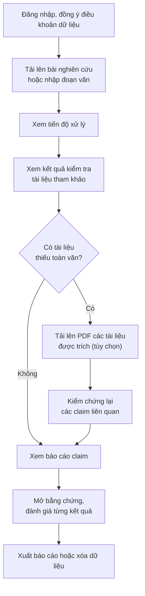

# 04 — Product Requirements Document: CiteProof AI (MVP)

| Thuộc tính | Giá trị |
|---|---|
| Phiên bản | 0.1 |
| Phase | Phase 2 — Requirements Engineering |
| Ngày cập nhật | 20/11/2026 |
| Trạng thái | Bản nháp trước |
| Bao gồm | Requirements specification (thay `05`), user stories và use cases (thay `06`), theo D-09 |
| Tài liệu liên quan | `00-project-overview.md`, `02-market-user-research.md`, `07-technical-architecture.md` |

---

## 1. Overview

PRD mô tả **CiteProof AI MVP Pilot**: phiên bản phục vụ một nhóm nhỏ người dùng thử, theo phạm vi D-04. Tài liệu định nghĩa hành trình người dùng, yêu cầu chức năng và phi chức năng, các bộ trạng thái, user stories, use cases và nội dung báo cáo.

## 2. Objectives

| ID | Mục tiêu sản phẩm (từ `00` §2.1) | Cách đo `[ĐX]` |
|---|---|---|
| SP-1 | Người dùng phát hiện được tài liệu tham khảo sai metadata hoặc chưa tìm thấy, mà không bị gán nhầm là "bịa trích dẫn" | Phản hồi pilot; tỷ lệ "chưa tìm thấy" thực ra có tồn tại trên tập đánh giá D5 (`13`) |
| SP-2 | Người dùng biết trích dẫn nào có thể không hỗ trợ nhận định, kèm bằng chứng | Macro-F1 trên tập đánh giá; tỷ lệ người dùng đồng ý với kết quả (FR-70) |
| SP-3 | Nhóm pilot dùng được prototype và phản hồi | Số người hoàn thành ít nhất một lần chạy; số phản hồi |

Ngưỡng định lượng chỉ đặt sau khi có baseline (theo `00` §2.3).

## 3. Scope

Phạm vi trong và ngoài MVP theo `00` §3.2–§3.3. Bản phát hành này gọi là **MVP Pilot Release**.

## 4. Detailed Analysis

### 4.1 Người dùng

Theo persona ở `02` §4.2: P1 (sinh viên năm cuối CNTT) là người dùng chính; P2 (học viên cao học, nghiên cứu sinh) là người dùng phụ. Ngoài ra có vai trò **Quản trị / nghiên cứu viên** (chính bạn), dùng các chức năng chạy biến thể và xem chỉ số.

### 4.2 Hành trình người dùng chính

### 4.3 Functional Requirements

**Đầu vào tài liệu**

| ID | Yêu cầu | Ưu tiên | Nguồn |
|---|---|---|---|
| FR-01 | Tải lên PDF hoặc DOCX; từ chối file sai định dạng hoặc vượt giới hạn kích thước, số trang (giới hạn chốt ở Phase 3) | P0 | v1.0 F01 |
| FR-02 | Nhập văn bản: đoạn văn kèm danh mục tài liệu tham khảo | P0 | v1.0 §4.1 |
| FR-03 | Tự nhận diện ngôn ngữ bài: tiếng Việt, tiếng Anh hoặc hỗn hợp | P0 | D-06 |
| FR-04 | Cảnh báo khi văn bản trích xuất có dấu hiệu lỗi (bảng mã cũ, PDF dạng ảnh scan) | P0 | `01` §4.5.1 |
| FR-05 | Cảnh báo khi bài có vẻ ngoài lĩnh vực CS–AI, nhưng vẫn xử lý | P1 | P-04 |

**Tài liệu tham khảo**

| ID | Yêu cầu | Ưu tiên | Nguồn |
|---|---|---|---|
| FR-10 | Tách danh mục tài liệu tham khảo; mỗi mục giữ nguyên chuỗi gốc | P0 | v1.0 F04 |
| FR-11 | Phân tích các trường (tác giả, tiêu đề, năm, nơi xuất bản, DOI, ISBN, URL) và phân loại loại tài liệu | P0 | v1.0 F04 |
| FR-12 | Tra cứu trong các nguồn metadata và gán trạng thái theo §4.5.2 | P0 | D-07 |
| FR-13 | Với `METADATA_MISMATCH`: chỉ rõ trường bị lệch và giá trị tìm thấy | P0 | v1.0 §2.2A |
| FR-14 | Với `NOT_FOUND_IN_SEARCHED_SOURCES`: liệt kê các nguồn đã tra; không dùng từ "không tồn tại" hay "giả mạo" | P0 | D-07 |
| FR-15 | Với tài liệu web: kiểm tra URL còn hoạt động và có bản lưu trữ hay không | P1 | `01` §4.5.2 |

**Trích dẫn và claim**

| ID | Yêu cầu | Ưu tiên | Nguồn |
|---|---|---|---|
| FR-20 | Phát hiện marker trích dẫn trong văn bản, cả kiểu số và kiểu tác giả–năm | P0 | v1.0 F04 |
| FR-21 | Liên kết marker với mục tài liệu tham khảo; báo marker không liên kết được và tài liệu tham khảo không được trích lần nào | P0 | v1.0 §2.2A |
| FR-22 | Xác định câu chứa trích dẫn và phần nhận định mà trích dẫn được dùng để hỗ trợ | P0 | v1.0 F03 |

**Nguồn và truy cập**

| ID | Yêu cầu | Ưu tiên | Nguồn |
|---|---|---|---|
| FR-30 | Xác định trạng thái truy cập của từng tài liệu được trích, theo v1.0 §9.3 | P0 | v1.0 §9.3 |
| FR-31 | Tự động lấy toàn văn mở khi có | P0 | D-04 |
| FR-32 | Hiển thị danh sách tài liệu thiếu toàn văn và cho phép tải lên PDF tương ứng | P0 | D-08 |
| FR-33 | Kiểm tra file tải lên có khớp với mục tài liệu tham khảo (theo tiêu đề) và cảnh báo khi không khớp | P0 | D-08 |
| FR-34 | Sau khi người dùng tải thêm tài liệu, chỉ kiểm chứng lại các claim liên quan, không chạy lại toàn bộ | P1 | D-08 |

**Kiểm chứng**

| ID | Yêu cầu | Ưu tiên | Nguồn |
|---|---|---|---|
| FR-40 | Đánh giá mỗi cặp claim–tài liệu được trích bằng một trong năm trạng thái claim (§4.5.1) | P0 | v1.0 §11.1 |
| FR-41 | Mọi kết luận khác `UNVERIFIABLE` phải có ít nhất một đoạn bằng chứng trích nguyên văn từ nguồn, kèm vị trí | P0 | v1.0 §11.3 |
| FR-42 | `UNVERIFIABLE` luôn đi kèm một lý do thuộc danh mục §4.5.3 | P0 | D-04 |
| FR-43 | Ghi rõ kết luận dựa trên abstract hay toàn văn | P0 | v1.0 §9.3 |
| FR-44 | Gắn cờ "nên tự kiểm tra" cho các trường hợp ở §4.5.4 | P0 | C-3 |
| FR-45 | Giải thích ngắn, viết bằng ngôn ngữ của bài (Việt hoặc Anh) | P0 | D-06 |

**Báo cáo**

| ID | Yêu cầu | Ưu tiên | Nguồn |
|---|---|---|---|
| FR-50 | Báo cáo gồm các phần ở §4.8 | P0 | v1.0 F11 |
| FR-51 | Xem bằng chứng: đoạn nguồn, vị trí trang/mục, liên kết tới nguồn | P0 | v1.0 F12 |
| FR-52 | Lọc kết quả theo trạng thái và theo tài liệu tham khảo | P1 | — |
| FR-53 | Xuất báo cáo dạng Markdown hoặc HTML; PDF nếu kịp | P1 | — |

**Tài khoản và dữ liệu**

| ID | Yêu cầu | Ưu tiên | Nguồn |
|---|---|---|---|
| FR-60 | Đăng nhập cho người dùng pilot | P0 | — |
| FR-61 | Mỗi người dùng chỉ thấy dữ liệu của mình | P0 | v1.0 §15.3 |
| FR-62 | Xóa tài liệu kèm toàn bộ dữ liệu liên quan; xóa tài khoản | P0 | v1.0 §15.3 |
| FR-63 | Thông báo rõ nội dung sẽ được gửi tới nhà cung cấp LLM bên ngoài và xin đồng ý trước lần dùng đầu tiên | P0 | Q-03 |

**Phản hồi và nghiên cứu**

| ID | Yêu cầu | Ưu tiên | Nguồn |
|---|---|---|---|
| FR-70 | Người dùng đánh giá từng kết quả (đồng ý / không đồng ý / không chắc), kèm ghi chú | P0 | `01` E6 |
| FR-80 | Quản trị viên chọn biến thể kiểm chứng theo cấu hình | P1 | NC-2 |
| FR-81 | Ghi lại model, phiên bản prompt, chi phí và thời gian cho mỗi lần chạy | P0 | v1.0 §10.4 |

### 4.4 Non-functional Requirements

| ID | Yêu cầu | Ưu tiên |
|---|---|---|
| NFR-01 | Xử lý bất đồng bộ; người dùng xem được tiến độ theo từng giai đoạn | P0 |
| NFR-02 | Thời gian xử lý mục tiêu cho một bài: đặt sau khi có số đo từ SPK-05 `[ĐX]` | P0 |
| NFR-03 | Hiển thị kết quả kiểm tra tài liệu tham khảo trước khi phần kiểm chứng claim hoàn tất | P1 |
| NFR-04 | Lần chạy bị lỗi có thể tiếp tục từ giai đoạn lỗi, không phải chạy lại từ đầu | P0 |
| NFR-05 | Truy xuất nguồn gốc: mọi kết luận liên kết được tới bằng chứng, nguồn, model và phiên bản prompt | P0 |
| NFR-06 | Tái lập: cùng cấu hình và cùng cache cho cùng kết quả trên tập đánh giá | P0 |
| NFR-07 | Bảo mật và quyền riêng tư theo `10` | P0 |
| NFR-08 | Kiểm soát chi phí: theo dõi chi phí từng lần chạy; giới hạn số claim mỗi lần chạy và hạn mức mỗi người dùng | P0 |
| NFR-09 | Giao diện tiếng Việt trước; nội dung giải thích theo ngôn ngữ của bài `[ĐX]` | P0 |
| NFR-10 | Một người bảo trì được: số dịch vụ tối thiểu; test tự động cho các module lõi | P0 |
| NFR-11 | Khả dụng ở mức pilot; không cam kết SLA | — |

### 4.5 Định nghĩa trạng thái

#### 4.5.1 Trạng thái claim

Giữ năm trạng thái của v1.0 §11.1, làm rõ cho bối cảnh MVP (chỉ xét chính tài liệu được trích):

| Trạng thái | Định nghĩa trong MVP |
|---|---|
| `SUPPORTED` | Tài liệu được trích nêu rõ điều mà claim khẳng định, trong phạm vi và điều kiện tương ứng |
| `PARTIALLY_SUPPORTED` | Tài liệu chỉ hỗ trợ một phần; claim rộng hơn, mạnh hơn, hoặc bỏ mất điều kiện so với nguồn |
| `CONTRADICTED` | Nội dung tài liệu được trích nói ngược với claim. MVP không tìm bằng chứng trái chiều ở nguồn khác |
| `UNSUPPORTED` | Đã đọc được toàn văn nhưng không có nội dung hỗ trợ claim |
| `UNVERIFIABLE` | Không đủ điều kiện kiểm chứng; luôn kèm lý do (§4.5.3) |

**Quy tắc abstract** `[ĐX]`: được phép kết luận `SUPPORTED`, `PARTIALLY_SUPPORTED` hoặc `CONTRADICTED` từ abstract khi abstract nêu rõ ràng. Không được kết luận `UNSUPPORTED` chỉ từ abstract: nếu chỉ có abstract và không thấy nội dung hỗ trợ, kết quả là `UNVERIFIABLE` với lý do `ABSTRACT_ONLY_INSUFFICIENT`. Lý do: abstract không nhắc đến một điều không có nghĩa là bài báo không nói điều đó.

#### 4.5.2 Trạng thái tài liệu tham khảo

Chốt từ bản nháp ở `01` §4.5.2:

| Trạng thái | Ý nghĩa | Cách diễn đạt với người dùng |
|---|---|---|
| `MATCHED` | Tìm thấy bản ghi, metadata khớp | "Đã xác minh", kèm nguồn đã tra |
| `METADATA_MISMATCH` | Tìm thấy bản ghi tương ứng nhưng lệch một số trường | Chỉ rõ trường lệch và giá trị tìm thấy |
| `NOT_FOUND_IN_SEARCHED_SOURCES` | Không tìm thấy trong các nguồn đã tra | "Chưa tìm thấy trong [danh sách nguồn]" |
| `UNSUPPORTED_TYPE` | Loại tài liệu chưa có cơ chế tra cứu | Nêu loại tài liệu; gợi ý tự kiểm tra hoặc tải lên |
| `PARSE_FAILED` | Không tách được thông tin từ chuỗi tài liệu tham khảo | Hiển thị chuỗi gốc để người dùng kiểm tra |

Tài liệu web có thêm hai thuộc tính: URL còn hoạt động hay không, có bản lưu trữ hay không.

#### 4.5.3 Lý do `UNVERIFIABLE`

| Mã | Ý nghĩa |
|---|---|
| `REFERENCE_UNRESOLVED` | Marker trích dẫn không liên kết được với mục tài liệu tham khảo nào |
| `REFERENCE_NOT_FOUND` | Tài liệu tham khảo chưa tìm thấy trong các nguồn đã tra |
| `NO_ACCESSIBLE_TEXT` | Không có toàn văn, không có abstract, người dùng chưa tải lên |
| `ABSTRACT_ONLY_INSUFFICIENT` | Chỉ có abstract và abstract không đủ để kết luận |
| `SOURCE_PARSE_FAILED` | Không trích xuất được văn bản từ nguồn |
| `SOURCE_LANGUAGE_UNSUPPORTED` | Nguồn viết bằng ngôn ngữ ngoài tiếng Việt và tiếng Anh |
| `NOT_A_CLAIM` | Câu trích dẫn không chứa nhận định kiểm chứng được (ví dụ "xem thêm [5]") |
| `PROCESSING_ERROR` | Lỗi hệ thống trong quá trình xử lý |

#### 4.5.4 Điều kiện gắn cờ "nên tự kiểm tra" `[ĐX]`

- Kết quả là `PARTIALLY_SUPPORTED` hoặc `CONTRADICTED`.
- Kết luận dựa trên abstract.
- Bằng chứng nằm trong vùng bảng hoặc hình (văn bản trích xuất kém tin cậy).
- File người dùng tải lên có cảnh báo không khớp với mục tài liệu tham khảo.
- Kết quả bị hạ mức bởi quy tắc kiểm tra bằng chứng (`07` §4.6).

#### 4.5.5 Quan hệ bằng chứng và trạng thái truy cập

Dùng nguyên danh mục của v1.0: quan hệ bằng chứng ở §11.2, trạng thái truy cập ở §9.3.

### 4.6 User Stories

| ID | User story | Acceptance criteria (Given / When / Then) | Ưu tiên |
|---|---|---|---|
| US-01 | Là sinh viên, tôi muốn tải lên khóa luận PDF để kiểm tra toàn bộ trích dẫn trong một lần | Given file PDF hợp lệ trong giới hạn; When tôi tải lên; Then hệ thống tạo một lần chạy và hiển thị tiến độ theo giai đoạn | P0 |
| US-02 | Là sinh viên, tôi muốn biết tài liệu tham khảo nào sai thông tin để sửa | Given lần chạy đã xong bước kiểm tra tài liệu tham khảo; When tôi mở kết quả; Then mỗi mục có trạng thái, và mục lệch metadata hiển thị trường lệch cùng giá trị tìm thấy | P0 |
| US-03 | Là sinh viên, tôi muốn hiểu vì sao một tài liệu "chưa tìm thấy", mà không bị coi là bịa đặt | Given một mục ở trạng thái `NOT_FOUND_IN_SEARCHED_SOURCES`; When tôi xem chi tiết; Then thấy danh sách nguồn đã tra và gợi ý cách tự kiểm tra; không có từ "không tồn tại" hay "giả mạo" | P0 |
| US-04 | Là sinh viên, tôi muốn tải lên PDF của các tài liệu thiếu toàn văn để hệ thống kiểm chứng được | Given danh sách tài liệu thiếu toàn văn; When tôi tải PDF cho một mục; Then hệ thống kiểm tra khớp tiêu đề, cảnh báo nếu không khớp, và kiểm chứng lại các claim liên quan | P0 |
| US-05 | Là sinh viên, tôi muốn thấy những nhận định nào có thể không được nguồn hỗ trợ | Given lần chạy hoàn tất; When tôi lọc trạng thái khác `SUPPORTED`; Then thấy danh sách claim kèm trạng thái, giải thích và cờ "nên tự kiểm tra" | P0 |
| US-06 | Là sinh viên, tôi muốn xem đoạn bằng chứng ở đúng vị trí trong nguồn | Given một kết quả có bằng chứng; When tôi mở bằng chứng; Then thấy đoạn trích nguyên văn, số trang hoặc mục, và liên kết tới nguồn | P0 |
| US-07 | Là người dùng, tôi muốn biết kết luận dựa trên abstract hay toàn văn | Given bất kỳ kết quả claim nào; When tôi xem; Then mức truy cập được hiển thị rõ | P0 |
| US-08 | Là sinh viên viết tiếng Việt và trích nguồn tiếng Anh, tôi muốn vẫn được kiểm chứng và giải thích bằng tiếng Việt | Given bài tiếng Việt trích nguồn tiếng Anh có toàn văn; When kiểm chứng xong; Then giải thích viết bằng tiếng Việt, đoạn bằng chứng giữ nguyên tiếng Anh | P0 |
| US-09 | Là người dùng, tôi muốn đánh dấu một kết quả là sai để góp ý | Given một kết quả bất kỳ; When tôi chọn "không đồng ý" và ghi chú; Then phản hồi được lưu và liên kết với kết quả đó | P0 |
| US-10 | Là người dùng, tôi muốn xóa bản thảo và mọi dữ liệu liên quan | Given tài liệu của tôi; When tôi xác nhận xóa; Then tài liệu, file đã tải lên, kết quả và chunk liên quan bị xóa | P0 |
| US-11 | Là nghiên cứu viên, tôi muốn chạy một biến thể kiểm chứng trên tập đánh giá và xem chỉ số | Given tập đánh giá và file cấu hình biến thể; When chạy lệnh đánh giá; Then nhận báo cáo chỉ số, kèm cấu hình, phiên bản model và prompt | P1 |
| US-12 | Là người dùng, tôi muốn kiểm tra nhanh một đoạn văn kèm danh mục tài liệu tham khảo | Given đoạn văn có marker và danh mục; When tôi gửi; Then nhận kết quả như với bài đầy đủ | P0 |

### 4.7 Use Cases

**UC-01: Kiểm tra một bài nghiên cứu**

| Mục | Nội dung |
|---|---|
| Tác nhân | Người dùng pilot |
| Điều kiện trước | Đã đăng nhập và đồng ý điều khoản dữ liệu (FR-63) |
| Luồng chính | 1. Tải lên PDF/DOCX. 2. Hệ thống kiểm tra file, tạo lần chạy. 3. Parse, nhận diện ngôn ngữ. 4. Tách và kiểm tra tài liệu tham khảo; hiển thị kết quả sớm. 5. Phát hiện trích dẫn, tách claim, liên kết. 6. Xác định truy cập, lấy toàn văn mở. 7. Kiểm chứng từng claim. 8. Tạo báo cáo |
| Luồng thay thế | 2a. File không hợp lệ: báo lỗi cụ thể. 3a. Văn bản lỗi bảng mã hoặc PDF scan: cảnh báo, vẫn tiếp tục nếu trích được nội dung. 4a. Không tách được danh mục tài liệu tham khảo: báo và gợi ý dùng đầu vào văn bản. 7a. Lỗi giữa chừng: lần chạy dừng ở giai đoạn lỗi, có thể tiếp tục (NFR-04) |
| Điều kiện sau | Báo cáo được lưu và xem lại được |

**UC-02: Bổ sung tài liệu được trích**

| Mục | Nội dung |
|---|---|
| Tác nhân | Người dùng pilot |
| Điều kiện trước | Có lần chạy với các claim ở trạng thái `UNVERIFIABLE` vì thiếu văn bản |
| Luồng chính | 1. Mở danh sách tài liệu thiếu toàn văn. 2. Tải PDF cho một mục. 3. Hệ thống kiểm tra khớp tiêu đề. 4. Parse, chia đoạn, lập chỉ mục. 5. Kiểm chứng lại các claim liên quan. 6. Cập nhật báo cáo |
| Luồng thay thế | 3a. Không khớp: cảnh báo; người dùng xác nhận vẫn dùng hoặc hủy |
| Điều kiện sau | File chỉ người dùng đó truy cập được |

**UC-03: Xem bằng chứng và phản hồi**

| Mục | Nội dung |
|---|---|
| Luồng chính | 1. Chọn một kết quả claim. 2. Xem đoạn bằng chứng và vị trí. 3. Chọn đồng ý / không đồng ý / không chắc, ghi chú nếu muốn |
| Điều kiện sau | Phản hồi được lưu, dùng cho phân tích lỗi (`15`) |

**UC-04: Kiểm tra đoạn văn** — giống UC-01, đầu vào là văn bản (FR-02), bỏ qua bước parse file.

**UC-05: Xóa dữ liệu**

| Mục | Nội dung |
|---|---|
| Luồng chính | 1. Chọn xóa tài liệu hoặc tài khoản. 2. Xác nhận. 3. Hệ thống xóa dữ liệu trong cơ sở dữ liệu và object storage |
| Điều kiện sau | Không còn dữ liệu của tài liệu đó, trừ log tối thiểu không chứa nội dung (`10`) |

### 4.8 Nội dung báo cáo MVP

Điều chỉnh từ v1.0 §12:

1. Tóm tắt.
2. Thông tin tài liệu và cảnh báo khi xử lý.
3. Thống kê: tài liệu tham khảo theo trạng thái, claim theo trạng thái, mức truy cập nguồn.
4. Kết quả từng tài liệu tham khảo.
5. Kết quả từng claim: nội dung gốc, trạng thái, giải thích, đoạn bằng chứng, nguồn và DOI, vị trí, mức truy cập, giới hạn, cờ "nên tự kiểm tra".
6. Các claim không kiểm chứng được và lý do.
7. Giới hạn chung của lần kiểm tra.
8. Gợi ý hành động: tải thêm tài liệu, sửa metadata, xem lại claim bị gắn cờ.

Nguyên tắc diễn đạt: không kết luận mạnh hơn bằng chứng cho phép; không dùng từ "bịa đặt" hay "gian lận"; mọi đoạn bằng chứng giữ nguyên văn và ngôn ngữ gốc.

### 4.9 Tiêu chí phát hành MVP Pilot

- [ ] Hoàn thành mọi FR và NFR ưu tiên P0.
- [ ] Đạt checklist bảo mật trước pilot (`10` §5).
- [ ] Đã chạy đánh giá baseline trên tập test (`13` §B).
- [ ] Đã thử toàn bộ luồng trên bài thật, cả tiếng Việt và tiếng Anh.

### 4.10 Quyết định cần chốt ở Phase 2

| Mã | Nội dung | Đề xuất |
|---|---|---|
| P-04 | Bài ngoài CS–AI | Xử lý, kèm cảnh báo (FR-05) |
| P-06 | Pilot hay public launch | Pilot nhóm nhỏ |
| C-1 | Calibration (Brier/ECE) | Hoãn khỏi MVP |
| C-3 | Human review trong MVP | Gắn cờ "nên tự kiểm tra" (§4.5.4) |
| — | Quy tắc abstract | Theo §4.5.1 |
| — | Ngôn ngữ giao diện | Tiếng Việt trước (NFR-09) |

## 5. Implementation Steps

- [ ] Rà soát PRD với kết quả Phase 1 (persona, pain point, go/no-go).
- [ ] Chốt các quyết định ở §4.10 và ghi vào Decision Log.
- [ ] Xác nhận danh sách P0.
- [ ] Bàn giao sang Phase 3: FR/NFR là đầu vào cho `07`–`10`.

## 6. Expected Outputs

PRD được chốt, gồm danh sách FR/NFR có ưu tiên, các bộ trạng thái, user stories có tiêu chí chấp nhận, use cases và nội dung báo cáo.

## 7. Dependencies

| Phụ thuộc | Mô tả |
|---|---|
| `02`, `03` | Kết quả Phase 1 có thể thay đổi ưu tiên |
| `07`–`10` | Thiết kế kỹ thuật dựa trên FR/NFR |
| `13` | Tập đánh giá dùng để đo SP-1, SP-2 |

## 8. Risks and Considerations

| Rủi ro | Giảm thiểu |
|---|---|
| P0 quá nhiều cho thời gian còn lại | Dùng thứ tự cắt giảm ở `11` §4.5 |
| Bộ trạng thái quá phức tạp với người dùng | Thử với người dùng pilot ở M3; đơn giản hóa cách hiển thị, giữ nguyên dữ liệu bên dưới |
| Quy tắc abstract làm tăng tỷ lệ `UNVERIFIABLE` | Chấp nhận để đổi lấy tính trung thực; khuyến khích tải lên tài liệu |

## 9. Acceptance Criteria

- [ ] Mọi FR có ID, ưu tiên và nguồn gốc.
- [ ] Mọi user story P0 có acceptance criteria kiểm tra được.
- [ ] Các bộ trạng thái được định nghĩa đầy đủ và nhất quán với `08`.
- [ ] Các quyết định ở §4.10 đã chốt.
- [ ] Không mâu thuẫn với phạm vi ở `00`.

## 10. References

- CiteProof AI Project Documentation v1.0: §2, §4, §9.3, §11, §12, §15.
- `00-project-overview.md`, `01-idea-analysis.md`, `02-market-user-research.md`.
