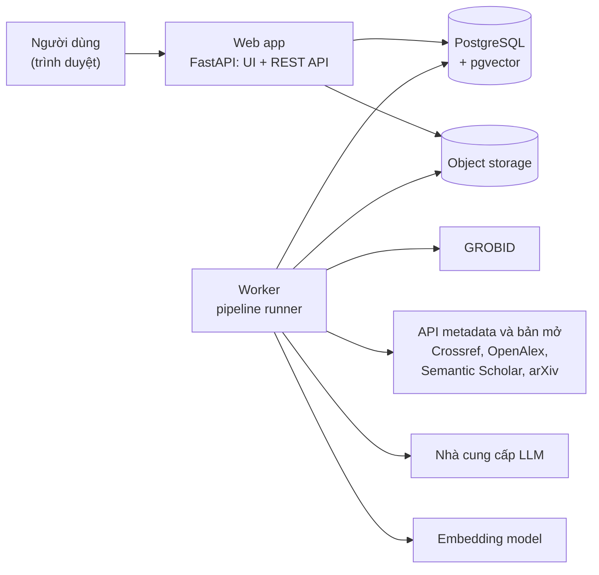
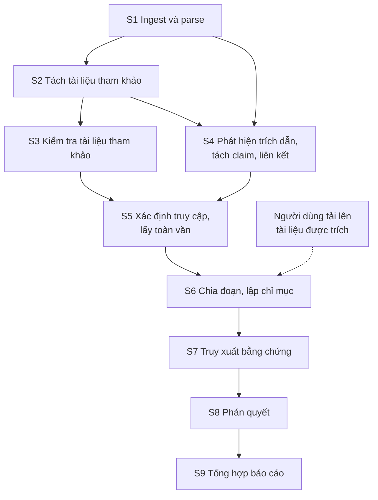

# 07 — Technical Architecture: CiteProof AI (MVP)

| Thuộc tính | Giá trị |
|---|---|
| Phiên bản | 0.1 |
| Phase | Phase 3 — System Architecture & Technical Design |
| Ngày cập nhật | 20/11/2026 |
| Trạng thái | Bản nháp trước |
| Tài liệu liên quan | `04-prd.md`, `07a-orchestration-memory-tools.md` (điều phối, bộ nhớ, công cụ LLM — đã duyệt, D-13), `08-database-design.md`, `09-api-interface-specification.md`, `10-security-risk-assessment.md` |

---

## 1. Overview

Kiến trúc kỹ thuật cho MVP Pilot: một modular monolith viết bằng Python, gồm web app và worker xử lý pipeline, dùng PostgreSQL làm kho dữ liệu chính kiêm vector store. Tài liệu đánh giá lại tech stack của v1.0 theo P-03, mô tả pipeline xử lý, thiết kế phần dùng LLM, cơ chế kiểm soát hallucination và các biến thể phục vụ thực nghiệm.

## 2. Objectives

- Đáp ứng FR/NFR P0 của `04`.
- Một người vận hành và bảo trì được (NFR-10).
- Hỗ trợ thực nghiệm: các biến thể kiểm chứng thay thế được qua cấu hình (FR-80).
- Truy xuất nguồn gốc và tái lập được (NFR-05, NFR-06).

## 3. Scope

**Trong phạm vi:** kiến trúc MVP, lựa chọn công nghệ, pipeline, thiết kế LLM, ADR đề xuất.

**Ngoài phạm vi:** chi tiết lược đồ (`08`), chi tiết API (`09`), bảo mật (`10`), triển khai (`14`).

## 4. Detailed Analysis

### 4.1 Các yếu tố chi phối kiến trúc

| Yếu tố | Nguồn | Hệ quả thiết kế |
|---|---|---|
| Một người vận hành | D-02, NFR-10 | Ít dịch vụ nhất có thể; tránh hạ tầng phân tán |
| Xử lý dài, gọi nhiều API bên ngoài | NFR-01, NFR-04 | Pipeline bất đồng bộ, theo giai đoạn, lưu kết quả từng giai đoạn |
| Truy xuất nguồn gốc | NFR-05 | Chuỗi ID từ claim đến bằng chứng, nguồn, model, prompt |
| Thực nghiệm nhiều biến thể | NC-2, FR-80 | Verifier dạng strategy, chọn qua cấu hình |
| Chi phí LLM | NFR-08 | Cache, giới hạn, ghi log chi phí từng lần gọi |
| Song ngữ | D-06 | Truy xuất đa ngôn ngữ hoặc dịch trước, là một tham số cấu hình |

### 4.2 Đánh giá lại tech stack của v1.0 (P-03)

| Thành phần | v1.0 | Đề xuất MVP `[ĐX]` | Lý do | ADR |
|---|---|---|---|---|
| Ngôn ngữ | Python | Giữ | Hệ sinh thái NLP/LLM | ADR-001 |
| Backend | FastAPI | Giữ | Async, tích hợp Pydantic | ADR-001 |
| Data contract | Pydantic v2 | Giữ | Validate đầu ra LLM và API | ADR-001 |
| Database | PostgreSQL + pgvector | Giữ | Một kho cho cả dữ liệu quan hệ, vector và full-text search | ADR-001 |
| ORM, migration | SQLAlchemy + Alembic | Giữ | Chuẩn, ổn định | ADR-001 |
| Điều phối | LangGraph | Pipeline Python tự viết, theo giai đoạn, trạng thái lưu trong DB. Hai agent có giới hạn (A1, A2) chạy bằng vòng lặp tự viết trên `LLMClient`, không dùng LangGraph (`07a`) | Luồng MVP gần như tuyến tính; checkpoint và retry đáp ứng được bằng trạng thái lưu từng giai đoạn; bớt một lớp trừu tượng khi debug; vòng lặp agent ≤8 bước không cần đồ thị hay checkpointer | ADR-002, ADR-009, ADR-010 |
| Hàng đợi tác vụ | Redis + worker | Hàng đợi trên PostgreSQL (bảng `jobs`, khóa `FOR UPDATE SKIP LOCKED`) | Bớt một dịch vụ (Redis); khối lượng pilot nhỏ | ADR-003 |
| Parse tài liệu | PyMuPDF, python-docx | GROBID cho PDF khoa học + PyMuPDF dự phòng + python-docx | GROBID tách sẵn tài liệu tham khảo và marker trích dẫn; cần kiểm chứng ở SPK-01 | ADR-004 |
| Giao diện | Next.js | Server-rendered bằng FastAPI + Jinja2 + HTMX cho pilot; Next.js sau MVP | Giữ toàn bộ mã nguồn bằng Python, đủ cho pilot | ADR-005 |
| Truy cập LLM | Model Gateway | Interface `LLMClient` nội bộ, bên dưới là `AnthropicProvider` dùng SDK `anthropic` chính thức (structured output, prompt caching, fallback phía server khi model từ chối). Model theo tác vụ, cấu hình được: W1–W4 `claude-haiku-5-5`, W5/A1/A2 `claude-sonnet-5-5`. Không có khóa API thì các bước LLM giảm cấp tất định | Giữ ý tưởng gateway nhưng mỏng; cache, log chi phí và phát lại tập trung ở `LLMClient`; lớp đa nhà cung cấp (ví dụ LiteLLM) không đem lại gì khi chỉ dùng một nhà cung cấp | ADR-006 |
| Open-weight model | Có | Hoãn sau MVP (Q-08) | Tránh vận hành GPU | — |
| Embedding | Chưa nêu | Chọn sau SPK-04: model đa ngôn ngữ tự chạy (ví dụ BGE-M3, multilingual-e5) hoặc API embedding | Phụ thuộc chất lượng xuyên ngôn ngữ và chi phí | ADR-007 |
| Kiểm tra tài liệu tham khảo | Tự xây | Cân nhắc tái sử dụng thành phần mã nguồn mở (`02` §4.3c) nếu giấy phép phù hợp | Nhiều công cụ đã có; tiết kiệm thời gian | ADR-008 |
| Lưu file | Local / object storage | Giữ | — | — |
| Container | Docker | Docker Compose | Đủ cho pilot | — |
| Chất lượng code | Ruff, mypy, pytest | Giữ | — | — |

Đây là đề xuất. Nếu bạn muốn giữ nguyên một lựa chọn của v1.0 (ví dụ LangGraph hoặc Next.js), ghi lại trong ADR tương ứng và cập nhật `11`.

Cập nhật 27/11/2026 (ADR-011): hãng LLM chưa được chọn (phụ thuộc nhà đầu tư), nên lớp truy cập LLM có thêm `OpenAICompatibleProvider` (SDK `openai`, Chat Completions) bên cạnh `AnthropicProvider`. `make_provider(settings)` chọn theo `CITEPROOF_LLM_PROVIDER`; mỗi provider có định danh riêng (`anthropic`, hoặc `openai_compatible:<host>`) dùng cho cache key, đóng băng vào lần chạy và đồng ý lại. Fallback phía server và prompt caching chỉ có ở Anthropic. ADR-006 vẫn đúng với `LLMClient` và `AnthropicProvider`.

### 4.3 Kiến trúc tổng thể



Web app chỉ nhận yêu cầu, ghi job vào bảng `jobs` và đọc kết quả. Mọi xử lý nặng và mọi lời gọi ra ngoài đều nằm trong worker.

### 4.4 Module (modular monolith)

| Module | Trách nhiệm | Phụ thuộc được phép |
|---|---|---|
| `documents` | Nhận file, kiểm tra, parse, nhận diện ngôn ngữ | `core`, `integrations.grobid`, `storage` |
| `references` | Tách, parse, tra cứu, gán trạng thái tài liệu tham khảo | `core`, `integrations.*`, `llm` |
| `citations` | Phát hiện marker, liên kết, tách claim | `core`, `llm` |
| `sources` | Xác định truy cập, lấy toàn văn, nhận file tải lên, chia đoạn | `core`, `integrations.*`, `storage` |
| `retrieval` | Lập chỉ mục và truy xuất bằng chứng | `core`, `llm` (embedding) |
| `verification` | Các verifier, quy tắc trạng thái, kiểm tra bằng chứng | `core`, `retrieval`, `llm` |
| `reports` | Tổng hợp báo cáo, xuất file | `core` |
| `pipeline` | Định nghĩa giai đoạn, chạy job, tiếp tục khi lỗi | Mọi module nghiệp vụ |
| `llm` | `LLMClient`, nạp prompt, cache theo namespace, ghi log lời gọi, `ContextBuilder`, `AgentRunner`, khung công cụ (`07a` §4.11) | `core` |
| `integrations` | Connector tới dịch vụ ngoài; HTTP client chống SSRF (`http_safe`) | `core` |
| `api`, `web` | REST API và giao diện | `pipeline`, module nghiệp vụ (chỉ đọc) |
| `evaluation` | Chạy biến thể trên tập đánh giá, tính chỉ số (chạy ngoài luồng sản phẩm) | `verification`, `retrieval` |

Quy tắc: module nghiệp vụ không gọi lẫn nhau tùy ý; giao tiếp qua domain model trong `core` và qua dữ liệu đã lưu, đúng tinh thần v1.0 §7.2.

### 4.5 Pipeline xử lý



| Giai đoạn | Đầu vào | Đầu ra (lưu DB) | LLM? | Ghi chú |
|---|---|---|---|---|
| S1 | File hoặc văn bản | Văn bản đã parse (object storage), ngôn ngữ, cảnh báo | Không | Phát hiện bảng mã cũ, PDF scan |
| S2 | Văn bản đã parse | `reference_entries` | Dự phòng | GROBID trước, LLM khi thất bại |
| S3 | `reference_entries` | `reference_checks`, `works`, `agent_runs` | Agent A1 khi leo thang | Tra cứu tuần tự tất định, chạy song song có giới hạn, ngắt mạch theo nguồn, `metadata_cache`; leo thang lên A1 theo `07a` §4.3.4 |
| S4 | Văn bản, `reference_entries` | `citations`, `citation_links`, `claims` | Có | Span claim phải là chuỗi con của câu gốc |
| S5 | `works`, file tải lên | `source_files` | Không | Ghi trạng thái truy cập và giấy phép |
| S6 | `source_files` | `source_chunks` + embedding + tsvector | Embedding (v1: không, ADR-007) | Giữ trang, mục, vị trí ký tự |
| S7 | `claims`, `source_chunks` | `retrieval_results` | Embedding / dịch (X2) | Lexical v1 (ADR-007): `ts_rank_cd` trên `tsv` trong một nguồn, các biến thể truy vấn (gốc, bản dịch W3 khi X2) gộp bằng RRF; vector khi xét lại ADR-007 |
| S8 | Claim + chunk ứng viên | `claim_verifications`, `evidence`, `agent_runs` (V4) | Có | Kiểm soát ở §4.6; worker và agent theo `07a` §4.4–§4.5 |
| S9 | Toàn bộ kết quả | Báo cáo (tạo khi xem, xuất file khi yêu cầu) | Không | — |

**Tính idempotent và tiếp tục khi lỗi:** mỗi giai đoạn ghi kết quả kèm `run_id`. Chạy lại một giai đoạn sẽ thay thế kết quả cũ của chính giai đoạn đó. Lần chạy lỗi tiếp tục từ giai đoạn chưa hoàn tất (NFR-04).

**Kiểm chứng lại khi có file mới (FR-34):** khi người dùng tải file cho một tài liệu tham khảo, hệ thống chạy S6–S9 chỉ cho các claim liên kết với tài liệu đó.

### 4.6 Thiết kế phần dùng LLM và kiểm soát hallucination

| Tác vụ | Dùng LLM | Đầu ra có cấu trúc | Kiểm soát |
|---|---|---|---|
| Parse tài liệu tham khảo (dự phòng) | Có | `ParsedReference` | So khớp lại các trường với chuỗi gốc |
| Tách span claim | Có | `ClaimSpan` | Span phải là chuỗi con của câu gốc |
| Dịch claim (chế độ X2) | Có | `TranslatedClaim` | Lưu bản dịch để kiểm tra lại |
| Phán quyết | Có | `Verdict` | Bảy cơ chế bên dưới |

Các cơ chế kiểm soát cho phán quyết:

1. **Evidence-first:** LLM chỉ thấy các chunk đã truy xuất, mỗi chunk có ID; phán quyết phải tham chiếu chunk ID.
2. **Kiểm tra trích dẫn nguyên văn:** mỗi đoạn bằng chứng LLM trả về phải xuất hiện nguyên văn trong chunk được tham chiếu (sau khi chuẩn hóa khoảng trắng). Đoạn không khớp bị loại. Nếu không còn bằng chứng hợp lệ, kết quả bị hạ về `UNVERIFIABLE` và gắn cờ.
3. **Quy tắc trạng thái tất định** áp dụng sau LLM. Ví dụ: `UNSUPPORTED` chỉ hợp lệ khi đã có toàn văn; nếu không, chuyển thành `UNVERIFIABLE` (`ABSTRACT_ONLY_INSUFFICIENT`) theo `04` §4.5.1.
4. **Validate schema** bằng Pydantic; thử lại có giới hạn khi đầu ra sai định dạng.
5. **Chống prompt injection:** văn bản tài liệu và nguồn đặt trong khối dữ liệu có phân tách rõ, đánh dấu không tin cậy; prompt hệ thống yêu cầu bỏ qua mọi chỉ dẫn nằm trong dữ liệu. Worker (W1–W5) không có công cụ. Agent A1, A2 chỉ có công cụ chỉ đọc, phạm vi khóa phía server; không agent nào có công cụ ghi, truy cập mạng tự do hay thực thi mã (`07a` §4.9).
6. **Tái lập bằng cache, không bằng nhiệt độ:** một số nhà cung cấp đã bỏ tham số nhiệt độ. Tái lập dựa vào model ID cố định và cache theo khóa (model, task, prompt version, schema version, input chuẩn hóa); agent cache theo từng bước (`07a` §4.7.2).
7. **Ghi log mọi lời gọi** vào `llm_calls`: model, prompt version, token, độ trễ, chi phí ước tính, cache hit.

### 4.7 Biến thể phục vụ thực nghiệm

| Mã | Biến thể | Mô tả |
|---|---|---|
| V0 | Closed-book LLM | Chỉ có claim và metadata tài liệu tham khảo, không có văn bản nguồn. Baseline thấp nhất, đo mức "đoán" |
| V1 | Abstract-only | Phán quyết chỉ dựa trên abstract |
| V2 | RAG toàn văn | Truy xuất top-k chunk từ toàn văn, phán quyết một bước |
| V3 | Pipeline nhiều bước | Tách claim thành các ý con, truy xuất cho từng ý, tổng hợp phán quyết |
| V4 | Agentic (tùy chọn) | Agent A2 tự điều hướng trong toàn văn (xem mục lục, tìm, đọc) rồi phán quyết; ≤8 bước (`07a` §4.5.3) |
| V2+A2 | Leo thang | V2 cho mọi claim; A2 kiểm tra lại các ca `UNSUPPORTED`/`PARTIALLY_SUPPORTED` có toàn văn. Ứng viên cấu hình mặc định cho sản phẩm, quyết định ở M7 |

| Mã | Chế độ xuyên ngôn ngữ | Mô tả |
|---|---|---|
| X1 | Trực tiếp | Embedding đa ngôn ngữ; claim tiếng Việt truy xuất thẳng trên nguồn tiếng Anh |
| X2 | Dịch trước | Dịch claim sang tiếng Anh, rồi truy xuất và phán quyết |

Biến thể và chế độ được chọn qua file cấu hình, lưu vào `verification_runs.config`. Sản phẩm dùng một cấu hình mặc định, chọn sau M7 dựa trên kết quả đánh giá.

### 4.8 Quản lý prompt

- Prompt lưu thành file trong repo: `prompts/<task>/<version>.md`, kèm schema đầu ra tương ứng.
- Mỗi kết quả ghi phiên bản prompt đã dùng.
- Thay đổi prompt là thay đổi có phiên bản: không sửa đè file prompt đang dùng; tạo phiên bản mới và chạy lại đánh giá trên tập dev trước khi đổi mặc định.
- Prompt chỉ được tinh chỉnh trên tập dev; tập test bị khóa (`13` §B).

### 4.9 Truy xuất nguồn gốc

Chuỗi liên kết cho mỗi kết luận:

```text
claim_verification → evidence → source_chunk (trang, mục, vị trí ký tự)
                   → source_file (nguồn gốc, trạng thái truy cập, giấy phép, thời điểm lấy)
                   → work (DOI, metadata) ↔ reference_entry → document
claim_verification → verification_run.config (biến thể, model, prompt version)
```

### 4.10 Khả năng mở rộng và điểm nghẽn

| Điểm nghẽn | Giảm thiểu |
|---|---|
| Độ trễ và chi phí LLM | Giới hạn số lời gọi đồng thời; cache; giới hạn số claim mỗi lần chạy |
| Giới hạn tốc độ API bên ngoài | Cache theo DOI và tiêu đề; backoff khi bị giới hạn; giới hạn đồng thời theo từng nguồn |
| Thông lượng GROBID | Một instance cho pilot; xếp hàng qua bảng `jobs` |
| PDF lớn | Giới hạn kích thước và số trang (FR-01) |
| Truy vấn vector | Tìm chính xác (không ANN) trong phạm vi một file nguồn: nhanh vì chỉ vài trăm chunk, và cho kết quả tất định để phát lại được (`07a` TK-19). Index HNSW chỉ thêm khi có truy vấn trên toàn kho |
| Chi phí agent | Ngân sách số bước và token cho từng agent; A2 chỉ chạy cho phần nhỏ claim ở chế độ leo thang (`07a` §4.8.5) |

### 4.11 ADR đề xuất

| ADR | Chủ đề | Trạng thái |
|---|---|---|
| ADR-001 | Giữ Python, FastAPI, Pydantic v2, PostgreSQL + pgvector, SQLAlchemy, Alembic | Đề xuất |
| ADR-002 | Pipeline tự viết thay cho LangGraph trong MVP | Đề xuất |
| ADR-003 | Hàng đợi trên PostgreSQL thay cho Redis | Đề xuất |
| ADR-004 | GROBID cho parse PDF, pypdfium2 dự phòng (`decisions/ADR-004-grobid-pdf-parsing.md`) | Accepted (24/11/2026); ngưỡng G-5 xem lại sau SPK-01 |
| ADR-005 | Giao diện server-rendered cho pilot | Accepted |
| ADR-006 | Lớp truy cập LLM: Anthropic SDK sau `LLMClient` (`decisions/ADR-006-llm-access-layer.md`) | Accepted (24/11/2026); Q-01, Q-03 còn mở |
| ADR-007 | Embedding và chiến lược xuyên ngôn ngữ (`decisions/ADR-007-embedding-strategy.md`) | Accepted cho v1 (24/11/2026); xem lại sau SPK-04 |
| ADR-008 | Tái sử dụng hay tự xây kiểm tra tài liệu tham khảo | Chờ T-002 |
| ADR-009 | Agent có giới hạn trong pipeline tất định (`decisions/ADR-009-bounded-agents-in-pipeline.md`) | Accepted (D-13) |
| ADR-010 | Hiện thực vòng lặp agent (`decisions/ADR-010-agent-loop-implementation.md`) | Accepted (25/11/2026), T-406 |

## 5. Implementation Steps

- [ ] Cập nhật theo kết quả SPK-01 đến SPK-05.
- [ ] Chốt từng ADR ở §4.11 bằng file trong `decisions/`.
- [ ] Đồng bộ `08`, `09` với các module và giai đoạn đã chốt.
- [ ] Vẽ lại workflow cuối cùng nếu ADR-002 thay đổi.

## 6. Expected Outputs

Kiến trúc MVP được chốt; các ADR được ghi; danh sách giai đoạn, module và biến thể làm cơ sở cho roadmap (`11`).

## 7. Dependencies

| Phụ thuộc | Mô tả |
|---|---|
| `04` | FR/NFR |
| `03` | Kết quả spike |
| `08`, `09`, `10` | Chi tiết hóa dữ liệu, interface, bảo mật |

## 8. Risks and Considerations

| Rủi ro | Giảm thiểu |
|---|---|
| Pipeline tự viết thiếu tính năng khi cần agentic | Interface `Verifier` cho phép thêm V4 bằng LangGraph mà không đổi phần còn lại |
| GROBID kém với khóa luận tiếng Việt | Parser LLM dự phòng; giới hạn định dạng đầu vào |
| Khóa chặt vào một nhà cung cấp LLM | Mọi lời gọi qua `LLMClient` |
| Giao diện server-rendered khó mở rộng | Chấp nhận cho pilot; API REST độc lập để front-end mới dùng lại |

## 9. Acceptance Criteria

- [ ] Mọi FR/NFR P0 được ánh xạ tới ít nhất một module hoặc giai đoạn.
- [ ] Mọi ADR ở §4.11 có trạng thái Accepted hoặc Rejected kèm lý do.
- [ ] Cơ chế kiểm soát hallucination (§4.6) có test tương ứng trong `13`.
- [ ] Không mâu thuẫn với `08`, `09`, `10`.

## 10. References

- CiteProof AI Project Documentation v1.0: §5–§9.
- `02-market-user-research.md` §4.3.
- `03-feasibility-study.md` §4.1.
