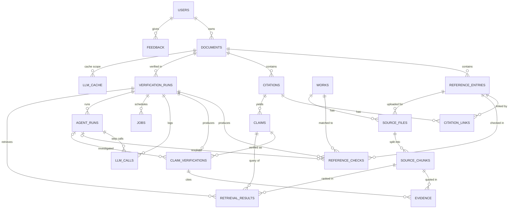

# 08 — Database Design: CiteProof AI (MVP)

| Thuộc tính | Giá trị |
|---|---|
| Phiên bản | 0.1 |
| Phase | Phase 3 — System Architecture & Technical Design |
| Ngày cập nhật | 20/11/2026 |
| Trạng thái | Bản nháp trước; mức chi tiết đủ cho MVP (D-09) |
| Tài liệu liên quan | `04-prd.md` §4.5, `07-technical-architecture.md` |

---

## 1. Overview

Lược đồ dữ liệu MVP trên PostgreSQL + pgvector. Dữ liệu dạng file (tài liệu gốc, văn bản đã parse, toàn văn nguồn) nằm trong object storage; cơ sở dữ liệu chỉ lưu tham chiếu. Dữ liệu đánh giá (benchmark) không nằm trong cơ sở dữ liệu sản phẩm mà nằm trong thư mục `benchmark/` (`13` §B).

Khi chạy đánh giá, harness nhập D1–D5 vào một **cơ sở dữ liệu riêng `citeproof_eval`**, dùng cùng lược đồ và cùng migration, dưới người dùng hệ thống `eval` (`07a` §4.3.6). Vì vậy mọi khóa ngoại ở dưới đều bắt buộc cả khi chạy đánh giá. Các bảng phục vụ bộ nhớ và agent (`agent_runs`, `retrieval_results`, `llm_cache`, `metadata_cache`) được thiết kế ở `07a` §4.7.

## 2. Objectives

- Lưu đủ dữ liệu cho truy xuất nguồn gốc (NFR-05) và tái lập (NFR-06).
- Hỗ trợ tiếp tục pipeline khi lỗi (NFR-04).
- Hỗ trợ xóa dữ liệu theo người dùng (FR-62).

## 3. Scope

Các bảng của MVP. Các thực thể của v1.0 nằm ngoài MVP (Team Workspace, tổ chức) chưa thiết kế.

## 4. Detailed Analysis

### 4.1 Sơ đồ quan hệ

`metadata_cache` đứng riêng, không có khóa ngoại: nó là cache dùng chung của phản hồi API công khai.

Tên bảng `reference_entries` được dùng thay cho `references` vì `REFERENCES` là từ khóa SQL.

### 4.2 Định nghĩa bảng

Quy ước chung: khóa chính `id UUID`; mọi bảng có `created_at TIMESTAMPTZ`; khóa ngoại có index.

**users**

| Cột | Kiểu | Ghi chú |
|---|---|---|
| email | TEXT UNIQUE | |
| password_hash | TEXT | Thuật toán băm theo `10` |
| display_name | TEXT | |
| role | ENUM(`user`, `admin`) | |
| consent_llm_at | TIMESTAMPTZ NULL | Thời điểm đồng ý điều khoản dữ liệu (FR-63) |
| deleted_at | TIMESTAMPTZ NULL | |

**documents**

| Cột | Kiểu | Ghi chú |
|---|---|---|
| user_id | FK users | |
| kind | ENUM(`FILE`, `TEXT`) | |
| filename, mime_type | TEXT | |
| storage_key | TEXT | File gốc trong object storage |
| parsed_key | TEXT NULL | Văn bản đã parse (JSON) trong object storage |
| sha256 | TEXT | |
| language | ENUM(`vi`, `en`, `mixed`, `unknown`) | |
| domain_flag | ENUM(`in_scope`, `out_of_domain`, `unknown`) | FR-05 |
| page_count | INT NULL | |
| parse_warnings | JSONB | Bảng mã cũ, PDF scan… |

**reference_entries**

| Cột | Kiểu | Ghi chú |
|---|---|---|
| document_id | FK documents | |
| order_index | INT | Thứ tự trong danh mục |
| raw_text | TEXT | Chuỗi gốc, không sửa |
| parsed | JSONB | `title`, `authors`, `year`, `venue`, `doi`, `isbn`, `url` |
| ref_type | ENUM(`ARTICLE`, `CONFERENCE`, `PREPRINT`, `BOOK`, `THESIS`, `WEB`, `OTHER`, `UNKNOWN`) | |
| parse_method | ENUM(`grobid`, `rule`, `llm`) | |
| doi_normalized | TEXT NULL | Chuẩn hóa trước khi lưu (v1.0 §10.4) |

**works** — bản ghi chuẩn hóa của một tài liệu khoa học, dùng chung giữa người dùng

| Cột | Kiểu | Ghi chú |
|---|---|---|
| doi | TEXT UNIQUE NULL | Đã chuẩn hóa |
| openalex_id, s2_id, arxiv_id, isbn | TEXT NULL | `arxiv_id` lưu dạng không kèm phiên bản (`2101.00001`, không phải `2101.00001v2`) |
| title | TEXT | |
| title_norm | TEXT | Chữ thường, chuẩn hóa NFC, bỏ dấu câu; dùng cho so khớp gần đúng (`07a` §4.7.1) |
| authors | JSONB | |
| year | INT NULL | |
| venue | TEXT NULL | |
| abstract | TEXT NULL | |
| language | TEXT NULL | |
| metadata_source | TEXT | Nguồn đã lấy metadata |
| retrieved_at | TIMESTAMPTZ | |

**reference_checks**

| Cột | Kiểu | Ghi chú |
|---|---|---|
| run_id | FK verification_runs | |
| reference_entry_id | FK reference_entries | |
| status | ENUM, theo `04` §4.5.2 (gồm `LOOKUP_FAILED`, D-12) | |
| work_id | FK works NULL | Khi tìm thấy |
| mismatches | JSONB | Trường lệch, giá trị trong bài và giá trị tìm thấy |
| sources_searched | TEXT[] | Chỉ gồm nguồn đã tra **thành công**; bắt buộc không rỗng với `NOT_FOUND_IN_SEARCHED_SOURCES` |
| sources_failed | TEXT[] | Nguồn lỗi hoặc bị ngắt mạch trong lần chạy; hiển thị trong báo cáo |
| resolved_by | ENUM(`cascade`, `agent`) | `agent` khi kết quả cuối đến từ A1 |
| agent_run_id | FK agent_runs NULL | |
| match_score | NUMERIC NULL | Điểm của bộ so khớp tất định |
| needs_user_review | BOOL | Ví dụ khớp qua tiêu đề khác ngôn ngữ, ứng viên sát điểm |
| url_alive | BOOL NULL | Tài liệu web |
| archive_url | TEXT NULL | Tài liệu web |

**source_files**

| Cột | Kiểu | Ghi chú |
|---|---|---|
| work_id | FK works NULL | |
| reference_entry_id | FK reference_entries NULL | Bắt buộc khi origin là `USER_UPLOAD` |
| owner_user_id | FK users NULL | Bắt buộc khi origin là `USER_UPLOAD` |
| origin | ENUM(`OPEN_ACCESS`, `USER_UPLOAD`) | |
| access_status | ENUM, theo v1.0 §9.3 | |
| content_level | ENUM(`ABSTRACT`, `FULL_TEXT`) | |
| url | TEXT NULL | Nơi lấy bản mở |
| license | TEXT NULL | |
| storage_key | TEXT | |
| sha256 | TEXT | |
| title_match | ENUM(`MATCH`, `MISMATCH`, `UNKNOWN`) | FR-33 |
| retrieved_at | TIMESTAMPTZ | |

**source_chunks**

| Cột | Kiểu | Ghi chú |
|---|---|---|
| source_file_id | FK source_files | |
| chunk_index | INT | |
| text | TEXT | |
| page | INT NULL | |
| section | TEXT NULL | |
| char_start, char_end | INT | Vị trí trong văn bản đã parse của nguồn |
| region | ENUM(`BODY`, `TABLE`, `FIGURE`, `OTHER`) | Dùng cho cờ "nên tự kiểm tra" |
| language | TEXT | |
| embedding | VECTOR(n) | n theo model chọn ở ADR-007 |
| embedding_model | TEXT | Tên model đã tạo embedding |
| tsv | TSVECTOR | Full-text search |

**citations**

| Cột | Kiểu | Ghi chú |
|---|---|---|
| document_id | FK documents | |
| marker_text | TEXT | Ví dụ `[3]` hoặc `(Nguyễn, 2020)` |
| sentence_text | TEXT | |
| page | INT NULL | |
| char_start, char_end | INT | |
| section | TEXT NULL | |

**citation_links**

| Cột | Kiểu | Ghi chú |
|---|---|---|
| citation_id | FK citations | |
| reference_entry_id | FK reference_entries NULL | NULL khi không liên kết được |
| link_method | ENUM(`numeric`, `author_year`, `llm`) | |

**claims**

| Cột | Kiểu | Ghi chú |
|---|---|---|
| document_id | FK documents | |
| citation_id | FK citations | |
| claim_text | TEXT | Phải là chuỗi con của `sentence_text` |
| context_text | TEXT | Câu trước và sau, nếu cần |
| language | TEXT | |
| extraction_method | TEXT | |

**verification_runs**

| Cột | Kiểu | Ghi chú |
|---|---|---|
| document_id | FK documents | |
| user_id | FK users | |
| status | ENUM, theo `09` §4.4 | |
| current_stage | ENUM(`S1`…`S9`) | |
| config | JSONB | Biến thể, chế độ xuyên ngôn ngữ, model, phiên bản prompt |
| started_at, finished_at | TIMESTAMPTZ | |
| error | JSONB NULL | |
| cost_estimate | NUMERIC | Tổng từ `llm_calls` |
| parent_run_id | FK verification_runs NULL | Lần kiểm chứng lại một phần (FR-34) |

**claim_verifications**

| Cột | Kiểu | Ghi chú |
|---|---|---|
| run_id | FK verification_runs | |
| claim_id | FK claims | |
| reference_entry_id | FK reference_entries | |
| status | ENUM, theo `04` §4.5.1 | |
| unverifiable_reason | ENUM NULL | Bắt buộc khi status là `UNVERIFIABLE`; danh mục `04` §4.5.3 (gồm `EVIDENCE_INCONCLUSIVE`, D-11) |
| content_level_used | ENUM(`NONE`, `ABSTRACT`, `FULL_TEXT`) | FR-43 |
| explanation | TEXT | |
| limitations | TEXT NULL | |
| needs_user_review | BOOL | FR-44 |
| downgraded_by_rule | TEXT NULL | Quy tắc đã hạ mức kết quả, nếu có |
| model, prompt_version | TEXT | |
| schema_version | TEXT | Ví dụ `verdict/2` |
| verifier | TEXT | `V0`…`V4`, `V2+A2` |
| agent_run_id | FK agent_runs NULL | Khi kết quả đến từ A2 |
| escalated_from | FK claim_verifications NULL | Kết quả V2 ban đầu, ở chế độ leo thang |

**evidence**

| Cột | Kiểu | Ghi chú |
|---|---|---|
| claim_verification_id | FK claim_verifications | |
| source_chunk_id | FK source_chunks | Bắt buộc (v1.0 §10.4) |
| relation | ENUM(`SUPPORTS`, `PARTIALLY_SUPPORTS`, `CONTRADICTS`, `RELATED`) | `07a` §4.6.3; ánh xạ với v1.0 §11.2 khi có bản gốc |
| quote_text | TEXT | Đã kiểm tra là chuỗi con của chunk |
| char_start, char_end | INT | Vị trí trong chunk |

**feedback**

| Cột | Kiểu | Ghi chú |
|---|---|---|
| user_id | FK users | |
| target_type | ENUM(`CLAIM_VERIFICATION`, `REFERENCE_CHECK`) | |
| target_id | UUID | |
| verdict | ENUM(`AGREE`, `DISAGREE`, `UNSURE`) | |
| comment | TEXT NULL | |

**llm_calls**

| Cột | Kiểu | Ghi chú |
|---|---|---|
| run_id | FK verification_runs NULL | NULL khi chạy đánh giá |
| stage, task | TEXT | |
| provider, model, prompt_version | TEXT | |
| input_tokens, output_tokens | INT | |
| latency_ms | INT | |
| cost_estimate | NUMERIC | |
| cache_hit | BOOL | |
| cache_key | TEXT NULL | Đặt NULL khi xóa tài liệu (số liệu giữ lại, không trỏ về nội dung) |
| cache_namespace | TEXT | `doc:<document_id>` hoặc `eval:<dataset>@<hash>` |
| agent_run_id | FK agent_runs NULL | Lời gọi thuộc một bước agent |
| step_index | INT NULL | |

**agent_runs** — quỹ đạo của A1, A2 (`07a` §4.5, §4.7.6)

| Cột | Kiểu | Ghi chú |
|---|---|---|
| run_id | FK verification_runs | |
| agent | ENUM(`reference_resolver`, `evidence_investigator`) | |
| agent_version, tool_catalog_version | TEXT | Nằm trong khóa cache |
| target_type | ENUM(`REFERENCE_ENTRY`, `CLAIM`) | |
| target_id | UUID | |
| status | ENUM(`SUBMITTED`, `NO_SUBMIT`, `BUDGET_EXHAUSTED`, `ERROR`) | |
| steps | JSONB | Mỗi bước: công cụ, tham số, kết quả rút gọn ≤2.000 ký tự, mã lỗi, token |
| final_output | JSONB NULL | Kết quả agent nộp, trước hậu xử lý tất định |
| n_steps, input_tokens, output_tokens | INT | |
| cost_estimate | NUMERIC | |
| started_at, finished_at | TIMESTAMPTZ | |

**retrieval_results** — thay "danh sách chunk ứng viên (tạm)" của S7

| Cột | Kiểu | Ghi chú |
|---|---|---|
| run_id | FK verification_runs | |
| claim_id | FK claims | |
| source_file_id | FK source_files | |
| source_chunk_id | FK source_chunks | |
| rank | INT | |
| score_lexical, score_vector, score_fused | REAL | |
| query_variant | TEXT | `original`, `translated`, `subclaim:s1`… |

**llm_cache** — cache đầu ra LLM (`07a` §4.7.2)

| Cột | Kiểu | Ghi chú |
|---|---|---|
| cache_key | TEXT PK | `sha256`, cách tính ở `07a` §4.7.2 |
| namespace | TEXT | `doc:<document_id>` hoặc `eval:<dataset>@<hash>` |
| document_id | FK documents NULL | Bắt buộc với namespace `doc:`; xóa cascade |
| task, model, prompt_version, schema_version | TEXT | |
| response | JSONB | |
| hit_count | INT | |

**metadata_cache** — cache dùng chung của phản hồi API metadata công khai

| Cột | Kiểu | Ghi chú |
|---|---|---|
| source | TEXT | `crossref`, `openalex`, `semantic_scholar`, `arxiv` |
| query_hash | TEXT | PK cùng `source`; **không lưu nguyên văn truy vấn** (truy vấn sinh từ bài của người dùng) |
| response | JSONB | |
| outcome | ENUM(`ok`, `not_found`, `error`) | |
| fetched_at, expires_at | TIMESTAMPTZ | TTL 30 ngày (`ok`), 7 ngày (`not_found`); không có TTL trong DB đánh giá |

**jobs** — hàng đợi trên PostgreSQL (ADR-003)

| Cột | Kiểu | Ghi chú |
|---|---|---|
| run_id | FK verification_runs | |
| stage | TEXT | |
| status | ENUM(`QUEUED`, `RUNNING`, `DONE`, `FAILED`) | |
| attempts | INT | |
| payload | JSONB | |
| locked_at, locked_by | TIMESTAMPTZ, TEXT | |
| last_error | TEXT NULL | |
| run_after | TIMESTAMPTZ | Phục vụ backoff |

### 4.3 Index chính

| Bảng | Index |
|---|---|
| works | UNIQUE(`doi`); index trên `arxiv_id`, `openalex_id`; GIN `pg_trgm` trên `title_norm` |
| source_chunks | GIN trên `tsv`; index trên `source_file_id`. Tìm vector là tìm chính xác trong một file nguồn, nên MVP không cần HNSW (`07a` TK-19) |
| jobs | Index trên (`status`, `run_after`) |
| claim_verifications | Index trên (`run_id`, `status`) |
| agent_runs | Index trên (`run_id`, `agent`), (`target_type`, `target_id`) |
| retrieval_results | Index trên (`run_id`, `claim_id`) |
| llm_cache | Index trên `namespace`, `document_id` |
| metadata_cache | PK (`source`, `query_hash`); index trên `expires_at` |
| Mọi khóa ngoại | Index thường |

### 4.4 Quy tắc toàn vẹn dữ liệu

Ánh xạ từ v1.0 §10.4:

- DOI chuẩn hóa (chữ thường, bỏ tiền tố URL) trước khi lưu.
- `evidence.source_chunk_id` bắt buộc; `evidence.quote_text` phải là chuỗi con của chunk (kiểm tra ở tầng ứng dụng).
- `claim_verifications.unverifiable_reason` bắt buộc khi trạng thái là `UNVERIFIABLE` (CHECK constraint).
- `reference_checks.sources_searched` không rỗng khi trạng thái là `NOT_FOUND_IN_SEARCHED_SOURCES`. Không tra được nguồn nào thì trạng thái là `LOOKUP_FAILED` (CHECK constraint).
- Bằng chứng tối thiểu theo trạng thái claim (`07a` §4.6.3): `SUPPORTED` cần ≥1 `SUPPORTS`; `PARTIALLY_SUPPORTED` cần ≥1 `SUPPORTS` hoặc `PARTIALLY_SUPPORTS`; `CONTRADICTED` cần ≥1 `CONTRADICTS`; `UNSUPPORTED` cần ≥1 `RELATED`. Kiểm tra ở tầng ứng dụng.
- `claim_verifications.agent_run_id` bắt buộc khi `verifier` là `V4` hoặc `V2+A2` và kết quả cuối đến từ A2.
- `llm_cache.document_id` bắt buộc khi `namespace` bắt đầu bằng `doc:`.
- File `USER_UPLOAD` bắt buộc có `owner_user_id` và không bao giờ được dùng cho người dùng khác, kể cả khi trùng `sha256`.
- Lưu model, phiên bản prompt và thời điểm truy xuất cho mọi kết quả.

### 4.4a Dạng dữ liệu JSON mà giao diện đọc

Chốt ngày 24/11/2026 (spec web UI §7.12). Các giai đoạn M2–M5 ghi đúng dạng này để giao diện hiển thị được mà không sửa.

| Trường | Dạng | Ghi chú |
|---|---|---|
| `reference_checks.mismatches` | Danh sách `{"field", "in_document", "found"}` như `09` §4.4 | Giá trị mặc định `{}` được hiểu là rỗng. `field` thuộc `title`, `authors`, `year`, `venue`, `doi` |
| `verification_runs.warnings` | Danh sách mã chuỗi | Khớp `StageResult.warnings`; câu hiển thị ở `.stitch/DESIGN.md` §8.6 |
| `documents.parse_warnings` | Danh sách `{"code", ...chi tiết}` | Ví dụ `{"code": "SCANNED_PAGES", "pages": [41, 42, 43]}`; `SAMPLE_DOCUMENT` đánh dấu bài mẫu |

Bảng xác thực thêm ở migration `0005`: `invites` (mã mời, lưu SHA-256), `web_sessions` (token phiên lưu SHA-256, token CSRF), `login_attempts` (giới hạn đăng nhập).

### 4.5 Lưu giữ và xóa dữ liệu

| Dữ liệu | Khi xóa tài liệu | Khi xóa tài khoản |
|---|---|---|
| documents và các bảng con | Xóa (cascade) | Xóa |
| File gốc và văn bản đã parse | Xóa trong object storage | Xóa |
| source_files dạng `USER_UPLOAD` và chunk | Xóa | Xóa |
| works, source_files dạng `OPEN_ACCESS` | Giữ (dùng chung, không chứa dữ liệu người dùng) | Giữ |
| feedback | Xóa theo mục tiêu | Xóa |
| `agent_runs`, `retrieval_results` | Xóa (cascade theo lần chạy) | Xóa |
| `llm_cache` namespace `doc:` | Xóa (cascade theo `document_id`) | Xóa |
| llm_calls | Giữ số liệu, bỏ liên kết nội dung (`cache_key` đặt NULL) | Giữ số liệu ẩn danh |
| `metadata_cache` | Giữ (chỉ chứa phản hồi API công khai, khóa là hash) | Giữ |

Thời hạn lưu giữ mặc định cho tài liệu không hoạt động `[ĐX]`: chốt ở `10`.

### 4.6 Migration

- Mọi thay đổi lược đồ đi kèm một migration Alembic (v1.0 §23).
- Không xóa cột hay bảng có dữ liệu khi chưa sao lưu.
- Migration chạy tự động khi triển khai (`14`).

## 5. Implementation Steps

- [ ] Chốt sau khi ADR-003 và ADR-007 được quyết định.
- [ ] Viết model SQLAlchemy và migration đầu tiên (T-104).
- [ ] Viết test cho các CHECK constraint và quy tắc xóa cascade.

## 6. Expected Outputs

Lược đồ MVP, migration đầu tiên, tài liệu enum đồng bộ với `04` và `09`.

## 7. Dependencies

`04` §4.5 (các bộ trạng thái), `07` (module, giai đoạn), `10` (chính sách lưu giữ).

## 8. Risks and Considerations

| Rủi ro | Giảm thiểu |
|---|---|
| Kích thước vector thay đổi khi đổi model embedding | Lưu tên model cùng chunk; migration tạo lại embedding |
| Bảng `llm_calls` lớn nhanh | Gộp số liệu định kỳ; xóa bản ghi chi tiết cũ |
| Enum thay đổi nhiều trong giai đoạn đầu | Dùng bảng tra hoặc kiểu TEXT kèm CHECK cho đến khi ổn định |

## 9. Acceptance Criteria

- [ ] Mọi thực thể cần cho FR P0 có bảng tương ứng.
- [ ] Enum khớp với `04` §4.5 và `09`.
- [ ] Quy tắc xóa đáp ứng FR-62.
- [ ] Truy được chuỗi liên kết ở `07` §4.9 bằng truy vấn SQL.

## 10. References

- CiteProof AI Project Documentation v1.0: §10.
- `07-technical-architecture.md` §4.5, §4.9.
