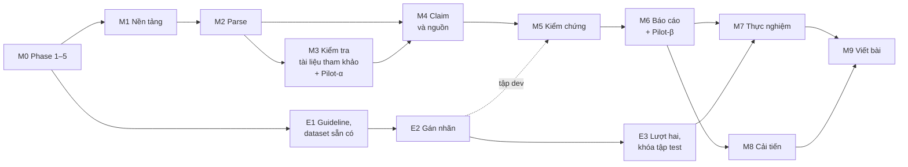

# 11 — Development Roadmap: CiteProof AI (MVP)

| Thuộc tính | Giá trị |
|---|---|
| Phiên bản | 0.1 |
| Phase | Phase 4 — Project Planning |
| Ngày cập nhật | 20/11/2026 |
| Trạng thái | Bản nháp trước |
| Tài liệu liên quan | `progress/task-tracking.md`, `07-technical-architecture.md`, `13-testing-strategy.md` |

---

## 1. Overview

Lộ trình MVP chia thành 10 milestone (M0–M9) trên hai luồng song song: **luồng sản phẩm** và **luồng đánh giá**. Thời lượng tính theo tuần, giả định bạn làm gần toàn thời gian `[GĐ]` (Q-10). Kế hoạch đặt phần lõi xong quanh tuần 15, phần còn lại dành cho thực nghiệm, pilot và viết bài, đúng tinh thần P-01.

## 2. Objectives

- Có lộ trình thực hiện được cho một người trong 3–6 tháng.
- Giải quyết các mâu thuẫn C-4 (giao diện đặt sớm cho pilot) và C-5 (đánh giá và baseline đặt sớm).
- Có thứ tự cắt giảm sẵn khi bị trễ.

## 3. Scope

Từ cuối Phase 1 đến khi có bản thảo bài báo và báo cáo dự án. Chi tiết task ở `progress/task-tracking.md`.

## 4. Detailed Analysis

### 4.1 Tổng quan milestone

| Milestone | Tuần `[ĐX]` | Mục tiêu | Kết quả bàn giao | Độ phức tạp |
|---|---|---|---|---|
| M0 | 1–3 | Hoàn tất Phase 1–5: nghiên cứu, spike, chốt tài liệu và ADR | Quyết định go/no-go; ADR; tài liệu đã cập nhật | M |
| M1 | 4 | Nền tảng: repo, Docker Compose, DB, job runner, CI, `LLMClient` | Hệ thống chạy được một job rỗng từ đầu đến cuối | M |
| M2 | 5–6 | Nhận và parse tài liệu, tách tài liệu tham khảo | Parse PDF/DOCX/văn bản; bộ test golden | L |
| M3 | 7–8 | Kiểm tra tài liệu tham khảo + giao diện tối thiểu | **Pilot-α** (chỉ phần kiểm tra tài liệu tham khảo) | M |
| M4 | 9–10 | Trích dẫn, claim, truy cập nguồn, tải lên, lập chỉ mục | Claim liên kết với nguồn đã lập chỉ mục | L |
| M5 | 11–13 | Engine kiểm chứng, biến thể V0–V2, X1/X2, harness đánh giá | Kiểm chứng claim có bằng chứng; chạy được đánh giá | L |
| M6 | 14–15 | Báo cáo, xem bằng chứng, phản hồi, xóa dữ liệu, triển khai | **Pilot-β** (MVP đầy đủ) | M |
| M7 | 16–19 | Thực nghiệm: các biến thể, ablation, phân tích lỗi, chi phí | Kết quả nghiên cứu | L |
| M8 | 20–21 | Cải tiến theo phản hồi pilot, gia cố | MVP Pilot ổn định | M |
| M9 | 22–24 | Viết bài, báo cáo dự án, vùng đệm | Bản thảo bài báo; tài liệu cuối | M |

Độ phức tạp: S (nhỏ), M (vừa), L (lớn).

**Luồng đánh giá (song song):**

| Hạng mục | Tuần `[ĐX]` | Kết quả |
|---|---|---|
| E1 | 3–5 | Annotation guideline v1; đánh giá dataset sẵn có (giấy phép, độ phù hợp) |
| E2 | 6–12 | Gán nhãn tập CS–AI tiếng Anh và tập tiếng Việt; tạo dữ liệu sinh có kiểm soát |
| E3 | 12–14 | Gán nhãn lượt hai cho tập con; tính độ nhất quán; khóa tập test |

### 4.2 Phụ thuộc giữa các milestone

### 4.3 Epic theo milestone

| Milestone | Epic |
|---|---|
| M0 | Nghiên cứu người dùng; literature review; spike; chốt PRD, kiến trúc, ADR; hướng dẫn phát triển |
| M1 | Tooling; hạ tầng local; lược đồ DB (gồm bảng bộ nhớ của `07a`); job runner; CI; lớp LLM (cache theo namespace, `ContextBuilder`); `http_safe` |
| M2 | Upload và kiểm tra file; parse PDF; parse DOCX; nhận diện ngôn ngữ và bảng mã; tách tài liệu tham khảo |
| M3 | Connector metadata; tra cứu tuần tự, ngắt mạch, `metadata_cache`; so khớp và gán trạng thái (gồm `LOOKUP_FAILED`); tài liệu web; giao diện tối thiểu; pilot-α |
| M4 | Marker và liên kết; tách claim (W2); xác định truy cập; tải lên tài liệu được trích; chia đoạn và lập chỉ mục; quyết định làm A1 theo SPK-02 và pilot-α; A1 nếu làm (P1) |
| M5 | Truy xuất hybrid và xuyên ngôn ngữ (`retrieval_results`); phán quyết W5 và kiểm soát; quy tắc trạng thái; biến thể V0–V2; kiểm chứng lại; harness đánh giá trên DB `citeproof_eval` |
| M6 | Báo cáo; xem bằng chứng; phản hồi; xóa dữ liệu; triển khai pilot; pilot-β |
| M7 | V3 (W4); `AgentRunner` và A2 (V4, `V2+A2`); chạy thực nghiệm; ablation; phân tích lỗi; chi phí và độ trễ; chọn cấu hình mặc định (có leo thang hay không) |
| M8 | Sửa theo phản hồi; checklist bảo mật; ổn định |
| M9 | Bài báo; báo cáo dự án; cập nhật tài liệu |

### 4.4 Definition of Done (chung cho mọi task)

- [ ] Code đạt Ruff, mypy, test tự động trong CI.
- [ ] Có test cho logic chính của task, theo `13`.
- [ ] Acceptance criteria của task đều đạt.
- [ ] Tài liệu liên quan được cập nhật; quyết định mới ghi vào Decision Log hoặc ADR.
- [ ] `progress/task-tracking.md` và `project-status.md` được cập nhật.

**Definition of Done cho milestone:** mọi task P0 của milestone đạt DoD; kết quả bàn giao chạy được; bạn xác nhận trước khi sang milestone tiếp theo.

### 4.5 Thứ tự cắt giảm khi bị trễ

Cắt theo thứ tự từ trên xuống, mỗi lần cắt ghi vào Decision Log:

1. Agent A2: biến thể V4 và chế độ leo thang `V2+A2` (`07a`).
2. Agent A1: giữ tra cứu tuần tự tất định.
3. Xuất báo cáo PDF (giữ Markdown/HTML).
4. Kiểm tra bản lưu trữ cho tài liệu web (FR-15).
5. Biến thể V3 (pipeline nhiều bước).
6. Kiểm chứng lại một phần (FR-34): thay bằng chạy lại toàn bộ.
7. Cảnh báo ngoài lĩnh vực (FR-05).
8. Tập claim tiếng Việt viết tự nhiên: chỉ giữ tập dịch.
9. Pilot-α: gộp vào pilot-β.

Không cắt: các kiểm soát hallucination (`07` §4.6), bộ trạng thái trung thực, checklist bảo mật, tập test bị khóa.

### 4.6 Rủi ro trong quá trình triển khai

| Rủi ro | Dấu hiệu sớm | Phản ứng |
|---|---|---|
| M2 kéo dài vì parse khó | Tuần 6 chưa đạt ngưỡng G-5 | Giới hạn định dạng đầu vào; tăng dùng đầu vào văn bản |
| Gán nhãn chậm | E2 chậm hơn tốc độ đo ở T-009 | Thu hẹp tập test; dựa nhiều hơn vào dataset sẵn có |
| Chi phí LLM vượt dự tính | Chi phí tuần vượt ngân sách | Cache chặt hơn; model rẻ hơn cho bước phụ; giảm số biến thể |
| Mệt mỏi khi làm một mình | Nhiều tuần liên tiếp trễ | Dùng thứ tự cắt giảm; giữ vùng đệm M9 |

## 5. Implementation Steps

- [ ] Trả lời Q-10 (số giờ mỗi tuần) và điều chỉnh tuần trong §4.1.
- [ ] Chọn ngày bắt đầu, đổi số tuần thành ngày cụ thể trong `project-status.md`.
- [ ] Xác nhận thứ tự cắt giảm §4.5.
- [ ] Rà soát lại roadmap ở cuối mỗi milestone.

## 6. Expected Outputs

Roadmap được chốt, có ngày cụ thể; danh sách task trong `progress/task-tracking.md`.

## 7. Dependencies

Kết quả Phase 1 (go/no-go), các ADR ở `07`, chiến lược đánh giá ở `13`.

## 8. Risks and Considerations

Số tuần ở đây là ước lượng ban đầu cho một người làm gần toàn thời gian, chưa dựa trên số đo năng suất thực tế. Sau M1 và M2, so sánh thời gian thực tế với ước lượng và điều chỉnh các milestone còn lại.

## 9. Acceptance Criteria

- [ ] Mọi FR P0 thuộc ít nhất một milestone.
- [ ] Mỗi milestone có kết quả bàn giao kiểm tra được.
- [ ] Có ngày bắt đầu và ngày kết thúc dự kiến.
- [ ] Thứ tự cắt giảm được xác nhận.

## 10. References

- `00-project-overview.md` P-01, P-05.
- `01-idea-analysis.md` C-4, C-5.
