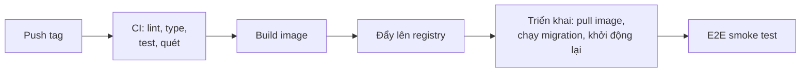

# 14 — Deployment & DevOps: CiteProof AI (MVP Pilot)

| Thuộc tính | Giá trị |
|---|---|
| Phiên bản | 0.1 |
| Phase | Phase 8 — Deployment & DevOps |
| Ngày cập nhật | 20/11/2026 |
| Trạng thái | Bản nháp trước; mức chi tiết đủ cho pilot (D-09) |
| Tài liệu liên quan | `07-technical-architecture.md`, `10-security-risk-assessment.md` |

---

## 1. Overview

Kế hoạch triển khai môi trường pilot với ít thành phần nhất mà vẫn an toàn: một máy chủ chạy Docker Compose, cơ sở dữ liệu có sao lưu, object storage, HTTPS. Không dùng Kubernetes (đúng v1.0 §14.2).

## 2. Objectives

- Triển khai lặp lại được bằng một lệnh.
- Bí mật quản lý an toàn.
- Có sao lưu và đã thử khôi phục.

## 3. Scope

Môi trường local và pilot. Ngoài phạm vi: môi trường production quy mô lớn.

## 4. Detailed Analysis

### 4.1 Môi trường

| Môi trường | Mục đích | Thành phần |
|---|---|---|
| Local | Phát triển, thực nghiệm | Docker Compose: app, worker, PostgreSQL + pgvector, GROBID; storage local |
| Pilot | Người dùng thử | Như local, chạy trên máy chủ; storage S3-compatible; HTTPS |

### 4.2 Phương án triển khai pilot `[ĐX]`

| Phương án | Mô tả | Ưu điểm | Nhược điểm |
|---|---|---|---|
| A. Một máy ảo + Docker Compose | Mọi dịch vụ trên một máy ảo; DB trong container hoặc DB được quản lý | Đơn giản, giống local, chi phí dễ đoán | Tự lo cập nhật hệ điều hành và sao lưu |
| B. PaaS + DB được quản lý | App và worker trên PaaS; DB và storage dịch vụ riêng | Ít việc vận hành hơn | GROBID cần RAM lớn có thể khó chạy trên PaaS; nhiều nhà cung cấp |

Đề xuất A cho pilot, có thể dùng DB được quản lý nếu có hỗ trợ pgvector. Cấu hình máy chọn theo yêu cầu RAM của GROBID đo ở SPK-01. Báo giá cụ thể lấy khi bắt đầu Phase 8.

### 4.3 Thành phần trên máy pilot

| Dịch vụ | Ghi chú |
|---|---|
| Reverse proxy | Cấp và gia hạn HTTPS tự động (ví dụ Caddy) `[ĐX]` |
| app | FastAPI: giao diện + API |
| worker | Pipeline runner; số worker cấu hình được |
| grobid | Chỉ truy cập nội bộ |
| postgres | Nếu không dùng DB được quản lý; không mở cổng ra ngoài |

### 4.4 Bí mật và cấu hình

- Biến môi trường từ file `.env` trên máy chủ, quyền đọc giới hạn; không nằm trong repo hay image.
- Danh sách bí mật: khóa LLM, khóa API nguồn dữ liệu (nếu có), thông tin DB, khóa storage, khóa ký phiên.
- Xoay khóa khi nghi lộ; ghi lại ngày xoay.

### 4.5 CI/CD

Triển khai chỉ từ tag đã qua CI. Có thể bắt đầu bằng script triển khai thủ công, tự động hóa sau.

### 4.6 Migration

- Migration Alembic chạy trước khi khởi động phiên bản mới.
- Sao lưu DB ngay trước migration có thay đổi phá vỡ dữ liệu.

### 4.7 Sao lưu và khôi phục

| Mục | Đề xuất `[ĐX]` |
|---|---|
| DB | Sao lưu hằng ngày ra object storage; giữ theo vòng quay |
| Object storage | Bật versioning hoặc sao lưu định kỳ nếu dịch vụ hỗ trợ |
| Thử khôi phục | Trước pilot và định kỳ sau đó |
| Mục tiêu | Mất tối đa dữ liệu một ngày ở quy mô pilot |

### 4.8 Giám sát tối thiểu

Health check `/api/v1/health`; theo dõi uptime từ bên ngoài; công cụ theo dõi lỗi ứng dụng `[ĐX]`; cảnh báo ngân sách LLM (`15`).

### 4.9 Rollback

Giữ image phiên bản trước; rollback bằng cách triển khai lại tag cũ. Nếu migration không đảo ngược được, khôi phục DB từ bản sao lưu ngay trước migration.

## 5. Implementation Steps

**Checklist triển khai pilot:**

- [ ] Chọn phương án §4.2 và nhà cung cấp; ghi vào Decision Log.
- [ ] Máy chủ: cập nhật hệ điều hành, tường lửa chỉ mở cổng HTTPS và SSH, SSH bằng khóa.
- [ ] HTTPS hoạt động.
- [ ] Bí mật nạp từ `.env` trên máy chủ.
- [ ] Migration chạy thành công.
- [ ] Sao lưu tự động hoạt động; đã thử khôi phục.
- [ ] Health check và theo dõi uptime hoạt động.
- [ ] E2E smoke test đạt trên môi trường pilot.
- [ ] Checklist bảo mật `10` §5 đạt.

## 6. Expected Outputs

Môi trường pilot chạy ổn định; script hoặc pipeline triển khai; quy trình sao lưu và rollback đã thử.

## 7. Dependencies

`07` (thành phần), `10` (bảo mật), SPK-01 (RAM GROBID), ngân sách (Q-01).

## 8. Risks and Considerations

| Rủi ro | Giảm thiểu |
|---|---|
| Một máy chủ là điểm lỗi duy nhất | Chấp nhận cho pilot; sao lưu và rollback đã thử |
| GROBID làm hết RAM | Giới hạn bộ nhớ container; chọn cấu hình máy theo SPK-01 |
| Quên cập nhật bảo mật máy chủ | Bật cập nhật bảo mật tự động; nhắc định kỳ trong `15` |

## 9. Acceptance Criteria

- [ ] Checklist §5 đạt toàn bộ.
- [ ] Triển khai lại từ đầu trên máy mới thành công theo tài liệu này.

## 10. References

- CiteProof AI Project Documentation v1.0: §14.
