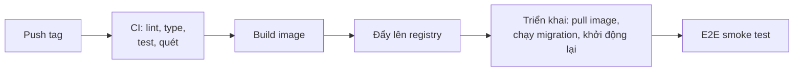

# 14 — Deployment & DevOps: CiteProof AI (MVP Pilot)

| Thuộc tính | Giá trị |
|---|---|
| Phiên bản | 0.1 |
| Phase | Phase 8 — Deployment & DevOps |
| Ngày cập nhật | 20/11/2026 |
| Trạng thái | Bản nháp trước; mức chi tiết đủ cho pilot (D-09) |
| Tài liệu liên quan | `07-technical-architecture.md`, `10-security-risk-assessment.md` |

---

## 1. Overview

Kế hoạch triển khai môi trường pilot với ít thành phần nhất mà vẫn an toàn: một máy chủ chạy Docker Compose, cơ sở dữ liệu có sao lưu, object storage, HTTPS. Không dùng Kubernetes (đúng v1.0 §14.2).

## 2. Objectives

- Triển khai lặp lại được bằng một lệnh.
- Bí mật quản lý an toàn.
- Có sao lưu và đã thử khôi phục.

## 3. Scope

Môi trường local và pilot. Ngoài phạm vi: môi trường production quy mô lớn.

## 4. Detailed Analysis

### 4.1 Môi trường

| Môi trường | Mục đích | Thành phần |
|---|---|---|
| Local | Phát triển, thực nghiệm | Docker Compose: app, worker, PostgreSQL + pgvector, GROBID; storage local |
| Pilot | Người dùng thử | Như local, chạy trên máy chủ; storage S3-compatible; HTTPS |

### 4.2 Phương án triển khai pilot `[ĐX]`

| Phương án | Mô tả | Ưu điểm | Nhược điểm |
|---|---|---|---|
| A. Một máy ảo + Docker Compose | Mọi dịch vụ trên một máy ảo; DB trong container hoặc DB được quản lý | Đơn giản, giống local, chi phí dễ đoán | Tự lo cập nhật hệ điều hành và sao lưu |
| B. PaaS + DB được quản lý | App và worker trên PaaS; DB và storage dịch vụ riêng | Ít việc vận hành hơn | GROBID cần RAM lớn có thể khó chạy trên PaaS; nhiều nhà cung cấp |

Đề xuất A cho pilot, có thể dùng DB được quản lý nếu có hỗ trợ pgvector. Cấu hình máy chọn theo yêu cầu RAM của GROBID đo ở SPK-01. Báo giá cụ thể lấy khi bắt đầu Phase 8.

### 4.3 Thành phần trên máy pilot

| Dịch vụ | Ghi chú |
|---|---|
| Reverse proxy | Cấp và gia hạn HTTPS tự động (ví dụ Caddy) `[ĐX]` |
| app | FastAPI: giao diện + API |
| worker | Pipeline runner; số worker cấu hình được |
| grobid | Chỉ truy cập nội bộ |
| postgres | Nếu không dùng DB được quản lý; không mở cổng ra ngoài |

### 4.4 Bí mật và cấu hình

- Biến môi trường từ file `.env` trên máy chủ, quyền đọc giới hạn; không nằm trong repo hay image.
- Danh sách bí mật: khóa LLM, khóa API nguồn dữ liệu (nếu có), thông tin DB, khóa storage, khóa ký phiên.
- Xoay khóa khi nghi lộ; ghi lại ngày xoay.

### 4.5 CI/CD

Triển khai chỉ từ tag đã qua CI. Có thể bắt đầu bằng script triển khai thủ công, tự động hóa sau.

### 4.6 Migration

- Migration Alembic chạy trước khi khởi động phiên bản mới.
- Sao lưu DB ngay trước migration có thay đổi phá vỡ dữ liệu.

### 4.7 Sao lưu và khôi phục

| Mục | Đề xuất `[ĐX]` |
|---|---|
| DB | Sao lưu hằng ngày ra object storage; giữ theo vòng quay |
| Object storage | Bật versioning hoặc sao lưu định kỳ nếu dịch vụ hỗ trợ |
| Thử khôi phục | Trước pilot và định kỳ sau đó |
| Mục tiêu | Mất tối đa dữ liệu một ngày ở quy mô pilot |

### 4.8 Giám sát tối thiểu

Health check `/api/v1/health`; theo dõi uptime từ bên ngoài; công cụ theo dõi lỗi ứng dụng `[ĐX]`; cảnh báo ngân sách LLM (`15`).

### 4.9 Rollback

Giữ image phiên bản trước; rollback bằng cách triển khai lại tag cũ. Nếu migration không đảo ngược được, khôi phục DB từ bản sao lưu ngay trước migration.

### 4.10 Vận hành pilot

Tệp: `docker-compose.prod.yml`, `docker/caddy/Caddyfile`, `.env.production.example`, `scripts/backup.sh`, `scripts/restore.sh`, `scripts/smoke.py`. Pilot dùng volume cục bộ cộng sao lưu hằng ngày (không dùng S3), không mở cổng nào ngoài 80/443 (Caddy). Mọi lệnh `docker compose` dưới đây có dạng `docker compose -f docker-compose.prod.yml --env-file .env.production …`.

**Triển khai lần đầu**

1. Trỏ DNS của `CITEPROOF_DOMAIN` về máy chủ; tường lửa chỉ mở 80, 443 và SSH.
2. `cp .env.production.example .env.production && chmod 600 .env.production`, thay mọi giá trị `CHANGE_ME_*` (xem danh sách bí mật), đặt `CITEPROOF_DOMAIN`. Để trống `CITEPROOF_CONTACT_EMAIL`, `CITEPROOF_WEB_ARCHIVE_LOOKUP=false` cho tới khi có quyết định. `CITEPROOF_LLM_PROVIDER_NAME` và `CITEPROOF_LLM_PROVIDER_POLICY_URL` chưa đặt: bắt buộc điền trước khi mời người dùng (`10` §5). Chọn provider LLM ở bước này (xem "Cấu hình provider LLM" bên dưới).
3. `docker compose … build && docker compose … up -d`. Service `migrate` chạy `alembic upgrade head` trước app/worker. Volume DB mới tạo cả `citeproof` lẫn `citeproof_eval` nhờ `./docker/db/init`; volume DB đã có từ trước thì tạo tay: `docker compose … exec db createdb -U citeproof citeproof_eval`.
4. Kiểm tra: `docker compose … ps`, `curl -fsS https://$DOMAIN/api/v1/health`, rồi `uv run python scripts/smoke.py --base-url https://$DOMAIN --email …` (tài khoản thử có sẵn; mật khẩu đọc từ biến `CITEPROOF_SMOKE_PASSWORD` hoặc được hỏi bằng getpass, không có tùy chọn `--password` để mật khẩu không vào argv/lịch sử shell).
5. Kiểm tra cấu hình tĩnh (thủ công, không chạy trong CI): `docker compose -f docker-compose.prod.yml --env-file .env.production config`.

**Cập nhật**: dừng worker (và app) trước khi chạy `alembic upgrade` hoặc service `migrate` (`docker compose … stop worker app`), nếu không job RUNNING của worker cũ có `lease_expires_at` NULL sẽ không bao giờ được thu hồi. Sau đó: `git fetch && git checkout <tag đã qua CI>`, `scripts/backup.sh` chạy tay qua `docker compose … exec backup /scripts/backup.sh` (bắt buộc nếu có migration phá vỡ dữ liệu), `docker compose … build`, `docker compose … up -d`, chạy lại smoke test. `CITEPROOF_CONSENT_TEXT_UPDATED_AT` được sao chép cùng file env nên không tự đổi: khi nội dung màn hình đồng ý thay đổi, cập nhật giá trị này trong `.env.production` (người đã đồng ý trước mốc đó phải đồng ý lại).

**Sao lưu**: service `backup` chạy `scripts/backup.sh` mỗi 24 giờ: `pg_dump -Fc` hai DB (`citeproof`, `citeproof_eval`) và `tar czf` volume storage vào `./backups` (`<db>-<UTC>.dump`, `storage-<UTC>.tar.gz`), xóa tệp cũ hơn `BACKUP_KEEP_DAYS` (mặc định 14). Tệp sao lưu có quyền 600 và thuộc root (chứa tài liệu người dùng), nên đọc, chép và chạy `restore.sh` cần `sudo`. Thư mục `./backups` nằm trên cùng máy: định kỳ chép sang nơi khác (rsync/scp) vì một máy là điểm lỗi duy nhất.

**Thử khôi phục** (trước pilot và định kỳ): trên máy thử hoặc ngay tại máy pilot ngoài giờ, `scripts/restore.sh backups/citeproof-<UTC>.dump backups/storage-<UTC>.tar.gz [backups/citeproof_eval-<UTC>.dump]`. Script dừng app/worker, `pg_restore --clean --if-exists`, nạp lại storage, khởi động lại; sau đó chạy smoke test và mở một báo cáo cũ để chắc dữ liệu và tệp khớp nhau. Ghi ngày thử vào Decision Log.

**Rollback**: `git checkout <tag cũ>`, `docker compose … build`, `docker compose … up -d`. Nếu bản mới đã chạy migration không đảo ngược được, chạy `scripts/restore.sh` với bản sao lưu lấy ngay trước cập nhật.

**Cấu hình provider LLM** (một provider mỗi lần triển khai, ADR-011): `CITEPROOF_LLM_PROVIDER=anthropic` (mặc định, cần `CITEPROOF_ANTHROPIC_API_KEY`) hoặc `openai_compatible`. Với `openai_compatible` đặt `CITEPROOF_OPENAI_BASE_URL` (+ `CITEPROOF_OPENAI_API_KEY` nếu máy chủ cần khóa), `CITEPROOF_LLM_MODELS`, `CITEPROOF_LLM_PRICES`, `CITEPROOF_LLM_PROVIDER_NAME`, `CITEPROOF_LLM_PROVIDER_POLICY_URL`:

| Provider | `CITEPROOF_OPENAI_BASE_URL` | Ghi chú |
|---|---|---|
| Anthropic | (không dùng) | `CITEPROOF_LLM_PROVIDER=anthropic`, model mặc định Claude |
| OpenAI | `https://api.openai.com/v1` | Cần khóa |
| Gemini | `https://generativelanguage.googleapis.com/v1beta/openai/` | Cần khóa Gemini |
| OpenRouter | `https://openrouter.ai/api/v1` | Cần khóa; model dạng `hãng/model` |
| Ollama | `http://host.docker.internal:11434/v1` (trong Docker) | Không cần khóa; giá `[0,0]`; worker có `extra_hosts: host.docker.internal:host-gateway` ở `docker-compose.yml` (file prod không có: tự thêm nếu dùng Ollama trên máy chủ) |

Bắt buộc với `openai_compatible` (sai thì app/worker không khởi động): `CITEPROOF_LLM_MODELS` là JSON đặt model cho **cả 8 tác vụ** (`reference.parse`, `claim.extract`, `claim.translate`, `claim.decompose`, `verdict.judge`, `verdict.judge_closed_book`, `agent.reference_resolver`, `agent.evidence_investigator`), map này thay hẳn mặc định (không trộn); khởi động từ chối khi thiếu khóa tác vụ hoặc thiếu giá của một model; `CITEPROOF_LLM_PRICES` là JSON `{"model":[đầu_vào,đầu_ra]}` (USD/1M token) cho mọi model đã dùng, model cục bộ `[0,0]`. Ví dụ đầy đủ cho OpenAI và Ollama ở `README.md` mục "Bật LLM". Tùy chọn: `CITEPROOF_OPENAI_TIMEOUT_SECONDS`, `CITEPROOF_OPENAI_MAX_RETRIES`, `CITEPROOF_OPENAI_STRUCTURED_OUTPUT` (`json_schema`/`json_object`/`none`), `CITEPROOF_OPENAI_SEND_REASONING_EFFORT`.

Hệ quả khi đổi provider (kể cả đổi host): mỗi lần chạy đã đóng băng provider nên báo cáo cũ bị chặn kiểm chứng lại/tiếp tục (`LLM_PROVIDER_CHANGED`, hiện thông báo tạo lần kiểm tra mới); mọi người dùng phải đồng ý lại (màn hình đồng ý nêu provider mới, nên cập nhật `CITEPROOF_LLM_PROVIDER_NAME` và `CITEPROOF_LLM_PROVIDER_POLICY_URL` cùng lúc); cache LLM tách riêng theo định danh (`anthropic` hoặc `openai_compatible:<host>[:port]`). `make eval-replay` dùng cache của provider đang cấu hình; muốn phát lại cache provider khác thêm `--provider-identity <định danh>` (chỉ replay). Thêm provider mới: xem README mục "Thêm một provider mới".

**Danh sách bí mật** (chỉ trong `.env.production`, quyền 600, không vào repo hay image): `POSTGRES_PASSWORD` (và cùng giá trị trong `CITEPROOF_DATABASE_URL`, `CITEPROOF_EVAL_DATABASE_URL`), `CITEPROOF_ANTHROPIC_API_KEY` hoặc `CITEPROOF_OPENAI_API_KEY` (theo provider), `CITEPROOF_SEMANTIC_SCHOLAR_API_KEY`, `CITEPROOF_OPENALEX_API_KEY` (hai khóa sau tùy chọn). Xoay khi nghi lộ và ghi ngày xoay. Script không in bí mật ra log.

## 5. Implementation Steps

**Checklist triển khai pilot:**

- [ ] Chọn phương án §4.2 và nhà cung cấp; ghi vào Decision Log.
- [ ] Máy chủ: cập nhật hệ điều hành, tường lửa chỉ mở cổng HTTPS và SSH, SSH bằng khóa.
- [ ] HTTPS hoạt động.
- [ ] Bí mật nạp từ `.env` trên máy chủ.
- [ ] Migration chạy thành công.
- [ ] Sao lưu tự động hoạt động; đã thử khôi phục.
- [ ] Health check và theo dõi uptime hoạt động.
- [ ] E2E smoke test đạt trên môi trường pilot.
- [ ] Checklist bảo mật `10` §5 đạt.

## 6. Expected Outputs

Môi trường pilot chạy ổn định; script hoặc pipeline triển khai; quy trình sao lưu và rollback đã thử.

## 7. Dependencies

`07` (thành phần), `10` (bảo mật), SPK-01 (RAM GROBID), ngân sách (Q-01).

## 8. Risks and Considerations

| Rủi ro | Giảm thiểu |
|---|---|
| Một máy chủ là điểm lỗi duy nhất | Chấp nhận cho pilot; sao lưu và rollback đã thử |
| GROBID làm hết RAM | Giới hạn bộ nhớ container; chọn cấu hình máy theo SPK-01 |
| Quên cập nhật bảo mật máy chủ | Bật cập nhật bảo mật tự động; nhắc định kỳ trong `15` |

## 9. Acceptance Criteria

- [ ] Checklist §5 đạt toàn bộ.
- [ ] Triển khai lại từ đầu trên máy mới thành công theo tài liệu này.

## 10. References

- CiteProof AI Project Documentation v1.0: §14.
