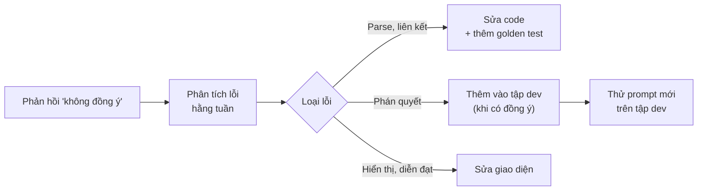

# 15 — Monitoring & Maintenance: CiteProof AI (MVP Pilot)

| Thuộc tính | Giá trị |
|---|---|
| Phiên bản | 0.1 |
| Phase | Phase 9 — Monitoring & Maintenance |
| Ngày cập nhật | 20/11/2026 |
| Trạng thái | Bản nháp trước; mức ngắn gọn theo D-09 |
| Tài liệu liên quan | `13-testing-strategy.md`, `14-deployment-devops.md` |

---

## 1. Overview

Cách theo dõi hệ thống, chất lượng và chi phí trong thời gian pilot; cách biến phản hồi thành cải tiến; quy trình nâng cấp model và prompt; quản lý nợ kỹ thuật.

## 2. Objectives

- Phát hiện sớm lỗi, chất lượng giảm và chi phí tăng.
- Dùng phản hồi pilot để cải thiện cả sản phẩm và tập đánh giá.
- Thay model hoặc prompt mà không làm giảm chất lượng một cách âm thầm.

## 3. Scope

Môi trường pilot và giai đoạn sau pilot.

## 4. Detailed Analysis

### 4.1 Chỉ số theo dõi

| Nhóm | Chỉ số | Nguồn dữ liệu |
|---|---|---|
| Hệ thống | Tỷ lệ lần chạy thành công / lỗi; thời gian xử lý mỗi bài; số job bị thử lại | `verification_runs`, `jobs` |
| Chi phí | Chi phí mỗi bài, mỗi ngày; tỷ lệ cache hit | `llm_calls` |
| Chất lượng | Phân bố trạng thái claim và tài liệu tham khảo; tỷ lệ `UNVERIFIABLE` theo lý do; tỷ lệ bằng chứng bị loại | `claim_verifications`, `reference_checks` |
| Người dùng | Số người dùng hoạt động; số lần chạy hoàn chỉnh; tỷ lệ "không đồng ý" trong phản hồi | `feedback`, `verification_runs` |

Giai đoạn pilot dùng các truy vấn SQL định sẵn hoặc một trang quản trị đơn giản; chưa cần hệ thống dashboard riêng.

### 4.2 Cảnh báo `[ĐX]`

| Cảnh báo | Điều kiện | Hành động |
|---|---|---|
| Ngân sách | Chi phí trong ngày hoặc tháng vượt ngưỡng | Tạm dừng nhận lần chạy mới; kiểm tra nguyên nhân |
| Lỗi tăng | Tỷ lệ lần chạy lỗi vượt ngưỡng | Xem log theo `run_id` |
| Dịch vụ ngừng | Health check thất bại | Kiểm tra máy chủ; rollback nếu do phiên bản mới |
| API ngoài | Lỗi giới hạn tốc độ liên tục từ một nguồn | Giảm đồng thời; kiểm tra điều khoản |

Ngưỡng cụ thể đặt khi triển khai pilot.

### 4.3 Vòng phản hồi

Chỉ thêm nội dung từ bản thảo của người dùng vào tập đánh giá khi có đồng ý riêng (`10` §4.3).

### 4.4 Quy trình nâng cấp model hoặc prompt

1. Tạo phiên bản prompt mới hoặc cấu hình model mới; không sửa đè phiên bản đang dùng.
2. Chạy đánh giá trên tập dev; so sánh với cấu hình hiện tại theo các chỉ số ở `13` §B.1, gồm cả chi phí.
3. Nếu tốt hơn hoặc ngang bằng với chi phí thấp hơn: chạy trên tập test ở mốc định trước.
4. Ghi quyết định vào Decision Log, kèm kết quả.
5. Đổi cấu hình mặc định; theo dõi chỉ số §4.1 trong tuần đầu.

Khi nhà cung cấp ngừng một model, áp dụng cùng quy trình cho model thay thế.

### 4.5 Bảo trì định kỳ `[ĐX]`

| Tần suất | Việc |
|---|---|
| Hằng tuần | Phân tích phản hồi; xem chi phí; xem lỗi |
| Hằng tháng | Cập nhật phụ thuộc; xem cảnh báo bảo mật; kiểm tra thay đổi điều khoản API nguồn dữ liệu |
| Hằng quý | Thử khôi phục sao lưu; rà soát nợ kỹ thuật; xóa dữ liệu hết hạn lưu giữ |

### 4.6 Sổ nợ kỹ thuật

| ID | Mô tả | Lý do chấp nhận tạm thời | Ảnh hưởng | Kế hoạch xử lý | Trạng thái |
|---|---|---|---|---|---|
| TD-001 | | | | | |

### 4.7 Đánh giá sau pilot

Cuối pilot, viết một bản tổng kết: chỉ số §4.1; phản hồi chính; tín hiệu willingness to pay; tính năng được dùng nhiều và ít; các giả định A-xx được xác nhận hay bác bỏ; đề xuất cho phiên bản tiếp theo (ví dụ các tính năng P1/P2 của v1.0).

## 5. Implementation Steps

- [ ] Viết các truy vấn SQL hoặc trang quản trị cho §4.1.
- [ ] Đặt ngưỡng và cấu hình cảnh báo §4.2.
- [ ] Lên lịch bảo trì §4.5.
- [ ] Viết bản tổng kết pilot §4.7.

## 6. Expected Outputs

Bộ chỉ số và cảnh báo hoạt động; quy trình nâng cấp có ghi chép; bản tổng kết pilot.

## 7. Dependencies

`13` (chỉ số, tập dev/test), `14` (môi trường, sao lưu), `08` (bảng dữ liệu nguồn).

## 8. Risks and Considerations

Một người không thể theo dõi liên tục. Ưu tiên cảnh báo tự động cho ngân sách và lỗi; các việc còn lại theo lịch cố định.

## 9. Acceptance Criteria

- [ ] Cảnh báo ngân sách và lỗi hoạt động trước khi mở pilot.
- [ ] Mỗi lần đổi model hoặc prompt mặc định có bản ghi trong Decision Log.
- [ ] Có bản tổng kết pilot.

## 10. References

- CiteProof AI Project Documentation v1.0: §21.
